# 📓 Bitácora del proceso — Nana, tu jardín de manga

Registro de cómo fue evolucionando la aplicación, versión por versión: qué se cambió, por qué, cómo se probó, cómo se usó la inteligencia artificial y qué problemas aparecieron.

> La app empezó con el nombre provisorio *Jardín de Manga*. Desde la v0.3 se llama **Nana** (ver la v0.3).


## Índice
| Versión | Fecha | Resumen |
|---|---|---|
| [Etapa 0 — La idea](#etapa-0--la-idea-09112026) | 09/11 | Lluvia de ideas y elección |
| [v0.1 — MVP](#versión-01--mvp-que-funcione-09112026) | 09/11 | CRUD con Firestore, GitHub y Vercel |
| [v0.2 — Pixel art](#versión-02--identidad-visual-pixel-art-y-mejor-experiencia-de-uso-10112026) | 10/11 | Identidad visual y experiencia de uso |
| [v0.3 — Nana + API](#versión-03--nombre-nuevo-búsqueda-con-api-y-edición-10112026) | 10/11 | Nombre, búsqueda en Kitsu, edición |
| [v0.4 — Comunidad](#versión-04--comunidad-clubes-misiones-con-roles-y-eventos-10112026) | 10/11 | Clubes, misiones por rol, eventos |
| [v0.4.1 — Ajustes](#versión-041--ajustes-de-la-versión-4-flores-únicas-guía-abeja-y-nana-ia-10112026) | 10/11 | Flores únicas, guía, abeja, Nana IA |
| [v1.0 — Final](#versión-10--versión-final-quinta-versión-10112026) | 10/11 | Ramo, filtros, herbario, sonidos, auditoría |
| [Conclusión](#conclusión-del-proceso) | | Qué se aprendió |

---

## Etapa 0 — La idea (09/11/2026)

### Punto de partida
Lo primero fue leer la consigna del TP2, la rúbrica, la consigna del examen final y las guías de teoría de la materia: Introducción a React, npm, módulos, props y hooks, APIs y arrays. El examen final consiste en **defender este mismo proyecto**, así que desde el inicio se buscó una app que use los temas vistos en clase y que se pueda seguir mejorando después.

### Lluvia de ideas
Le pedí a la IA ideas que mezclaran mis gustos (Minecraft, League of Legends, manga/anime y flores) y que permitieran agregar, consultar, modificar y eliminar datos. Surgieron cinco propuestas:

| Idea | De qué se trataba | Por qué sí / por qué no |
|---|---|---|
| **Jardín de Manga** ✅ | Cada manga/anime es una flor que crece según lo que leés | Une tres de mis gustos y es muy visual. Es una "vuelta de tuerca" al registro de libros que sugiere la consigna |
| Bloque a Bloque | Planificador de construcciones de Minecraft con materiales | Buena idea de inventario, pero menos original visualmente |
| Champion Lab | Diario de práctica de League of Legends | Correcta técnicamente, pero más "típica" |
| Quest Log | Tareas convertidas en misiones de videojuego | Muy cercana a la lista de tareas común |
| Herbario Otaku | Catálogo de flores que aparecen en animes | Original, pero con pocas acciones posibles |

### Decisión
Elegí **Jardín de Manga**. Las acciones que pide la consigna se convierten en acciones de jardinería:

| Lo que pide la consigna | En la app |
|---|---|
| Agregar un registro | **Plantar** un manga o anime |
| Consultar | Ver **mi jardín** |
| Modificar | **Regar** (+1 capítulo) y cambiar el estado |
| Eliminar | **Compostar** (quitar la planta) |

**¿Para quién es?** Para lectoras y lectores de manga y anime que siguen muchas series a la vez y quieren recordar por dónde iban, de una forma más linda que una lista o una planilla.

### Plan de versiones
Se planificaron 5 versiones, siguiendo la idea de **MVP** (producto mínimo viable) vista en clase: primero algo simple que funcione y después mejoras por etapas.

| Versión | Objetivo |
|---|---|
| v0.1 | Que funcione: guardar, ver, modificar y borrar en Firebase. Diseño básico a propósito |
| v0.2 | Identidad visual de jardín, versión para celular, mensajes claros |
| v0.3 | Buscar mangas/animes reales con una API (portadas y capítulos) |
| v0.4 | Filtros, buscador, estadísticas y significado de cada flor |
| v1.0 | Pulido final, pruebas completas y documentación |

---

## Versión 0.1 — MVP: que funcione (09/11/2026)

### Qué se hizo
1. **Se creó el proyecto** en Visual Studio Code con el comando visto en clase:
   `npm create vite@latest jardin-de-manga -- --template react`
2. **Se instalaron las dependencias** con `npm install` y la librería de Firebase con `npm install firebase`.
3. **Se borraron los archivos de ejemplo** de Vite (logos e imágenes de muestra) que no se iban a usar.
4. **Se organizó el código en archivos chicos**, uno por tarea, como recomienda la guía de módulos:
   - `firebase.js`: la conexión con Firebase.
   - `services/plantas.js`: las 4 operaciones con la base de datos (consultar, agregar, modificar, eliminar).
   - `data/flores.js`: qué flor corresponde a cada género y cómo se ve la planta según el avance.
   - `components/`: el formulario, la lista y la tarjeta de cada planta.
5. **Se escribieron las reglas de seguridad** de la base de datos (`firestore.rules`).
6. **Se preparó el archivo `.env.example`**, con los nombres de las llaves de Firebase pero sin sus valores.
7. **Se escribió el README** con las instrucciones para instalar y ejecutar.

### Cómo funciona esta versión (explicado simple)
- Cuando alguien abre la app, Firebase le da una **identidad anónima**: lo reconoce sin pedirle usuario ni contraseña.
- Cada persona tiene **su propio jardín** guardado en Firestore. Nadie más puede verlo ni modificarlo.
- El formulario permite **plantar** un manga o anime con título, tipo, género y cantidad de capítulos.
- Cada tarjeta muestra la planta con un emoji que cambia según el avance: 🫘 semilla → 🌱 brote → 🌿 creciendo → 🌹 en flor (o 🥀 si se abandona).
- Se puede **cambiar el estado**, **sumar un capítulo** y **eliminar**. Después de cada cambio, la app vuelve a pedirle los datos a Firebase, así lo que se ve en pantalla es lo que realmente quedó guardado.

### Lo que esta versión todavía NO tiene (a propósito)
Se deja anotado para mejorarlo en las próximas versiones:
- El diseño es muy básico: letra común, bordes grises, sin colores ni identidad.
- En el celular se ve, pero no está pensado para pantallas chicas.
- No hay mensajes de "¡guardado!": solo aparecen los errores.
- Borrar no pide confirmación, así que un clic por error elimina la planta.
- Hay que escribir los títulos a mano y no hay portadas.
- No se puede buscar ni filtrar dentro del jardín.
- Los emojis de las flores dependen del sistema de cada dispositivo y no se pueden personalizar.

### Uso de IA en esta etapa
- **Herramienta:** Claude Code (Claude, de Anthropic) dentro de la app de escritorio, trabajando sobre la carpeta del proyecto.
- **Ejemplos de lo que le pedí:**
  - *"Leé la teoría de todos los PDF y la consigna del TP2. Antes de crear cualquier aplicación, pensá ideas creativas y originales según lo que me gusta (Minecraft, LoL, manga, anime, flores) que permitan hacer todas las acciones que pide la consigna."*
  - *"Quiero avanzar con la idea del jardín de manga. Usamos Visual Studio Code, GitHub y lo que está en las teorías de los PDF, así que todo tiene que ser lo que vimos en clase."*
- **Qué revisé del resultado:** que el código use lo visto en clase (`useState`, `useEffect`, props, `map`, `try/catch/finally` como en la guía de props y hooks) y que la conexión con Firebase lea las llaves desde el `.env` con `import.meta.env`, como pide la consigna.

### Dificultades y cómo se resolvieron
| Problema | Cómo se detectó | Solución |
|---|---|---|
| El `.gitignore` que crea Vite **no incluía el archivo `.env`**. Si se subía así, las llaves de Firebase iban a quedar publicadas en GitHub | Revisando el archivo contra el paso 6 de la consigna | Se agregaron `.env` y sus variantes al `.gitignore` |
| Sin el `.env`, la app se rompía y mostraba la pantalla en blanco | Probando la app antes de tener Firebase configurado | La app ahora revisa si faltan llaves y muestra un aviso explicando qué hacer (captura 1) |
| Al compilar (`npm run build`) apareció la advertencia "*Some chunks are larger than 500 kB*" | Leyendo la terminal | No es un error, el sitio funciona igual. Se debe a que la librería de Firebase es pesada. Queda anotado como posible mejora |

### Pruebas realizadas
- `npm run dev`: la app abre en `http://localhost:5173/` ✅
- `npm run build`: compila sin errores ✅
- Sin `.env`: muestra el aviso de configuración en lugar de romperse ✅

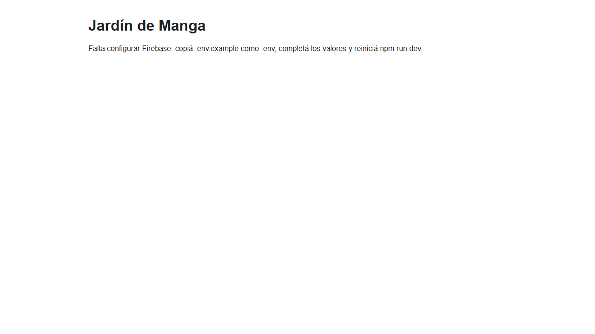
*Captura 1: la app corriendo en local antes de conectar Firebase. Avisa qué falta en lugar de mostrar una pantalla en blanco.*

### Configuración de Firebase (10/11/2026)
Se hizo desde la consola de Firebase, en el proyecto **Frontend II**, siguiendo las etapas 2 y 4 de la consigna:

1. **Se registró la app web** (botón `</>`) con el nombre `jardin-de-manga`. Firebase entregó el objeto `firebaseConfig` con las llaves de conexión. No se activaron Hosting ni Analytics porque no hacen falta.
2. **Se habilitó el acceso Anónimo** en *Authentication → Método de acceso*.
3. **Se creó la base Cloud Firestore**: edición Standard, identificador `(default)`, región São Paulo (`southamerica-east1`) y modo producción. Las copias de seguridad programadas quedaron desactivadas porque son de pago.
4. **Se publicaron las reglas** copiando el archivo `firestore.rules` en la pestaña *Reglas*.
5. **Se copiaron las 4 llaves** (apiKey, authDomain, projectId, appId) al archivo `.env`, una por línea y sin comillas ni comas.

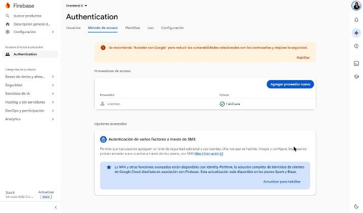
*Captura 2: el proveedor "Anónimo" habilitado en Authentication.*

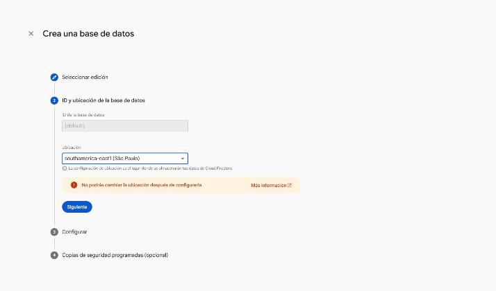
*Captura 3: creación de Firestore con la región São Paulo.*

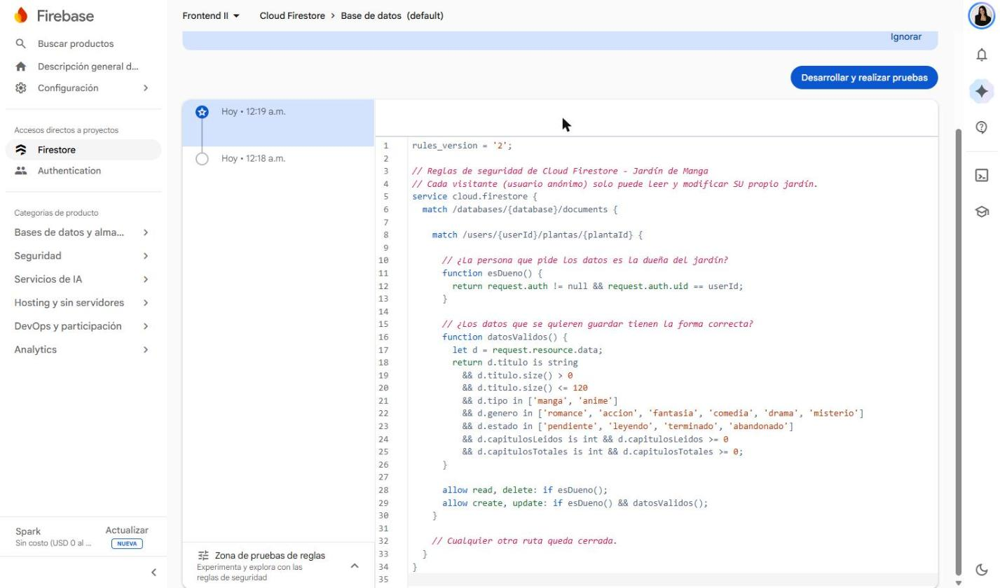
*Captura 4: las reglas del proyecto publicadas. A la izquierda se ve el historial con la versión nueva.*

### Prueba de integración en local (10/11/2026)
Se siguió el paso 5 de la consigna ("Verificar la integración") con `npm run dev`:

| Prueba | Qué se hizo | Resultado |
|---|---|---|
| Agregar | Se plantó "Frieren" (manga, fantasía, 4 capítulos) | ✅ Aparece como 🫘 semilla, 0/4 |
| Ver en Firestore | Se buscó en *Firestore → Datos* | ✅ Está en `users/(uid)/plantas/` con todos sus campos |
| Modificar | +1 capítulo dos veces y estado "Leyendo" | ✅ Pasa a 🌿 "Creciendo", 2/4 |
| Recargar | Se recargó la página (F5) | ✅ Los cambios siguen ahí |
| Ver el cambio en Firestore | Se abrió el documento | ✅ `capitulosLeidos: 2`, `estado: "leyendo"` |
| Eliminar | Se plantó "Prueba para borrar" y se eliminó | ✅ Desaparece de la app y de Firestore |

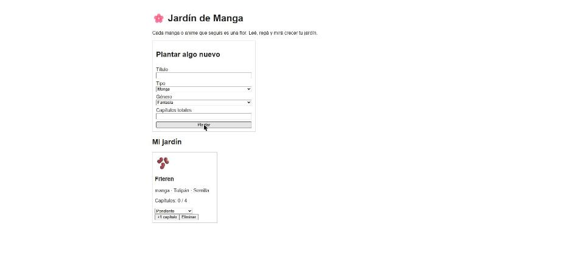
*Captura 5: el primer manga plantado. El diseño todavía es el básico del MVP.*

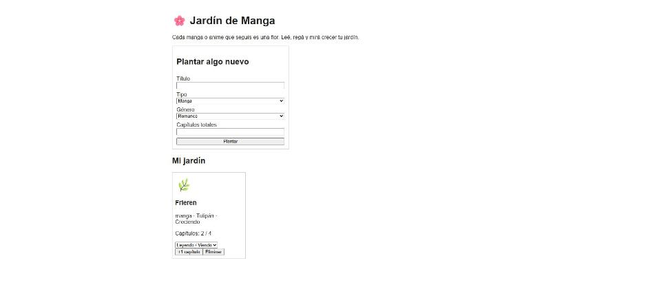
*Captura 6: después de recargar, Frieren sigue con 2/4 capítulos y en "Leyendo / Viendo".*

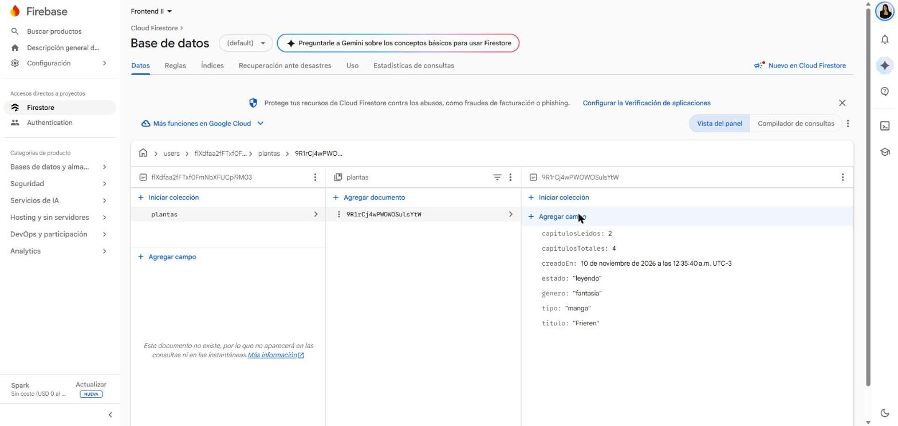
*Captura 7: el mismo dato guardado en Firestore. Los valores coinciden con la pantalla.*

### Más dificultades de esta etapa
| Problema | Cómo se detectó | Solución |
|---|---|---|
| `npm run dev` daba el error *"la ejecución de scripts está deshabilitada en este sistema"* | Al correr el comando por primera vez en la terminal de VS Code | Es una protección de Windows (PowerShell). Se aplicó el comando que indicó el profesor: `Set-ExecutionPolicy RemoteSigned -Scope CurrentUser` |
| Primero se escribió `run dev` en lugar de `npm run dev` | La terminal respondió que no reconocía "run" | El comando siempre empieza con `npm`, que es el programa que ejecuta los scripts del `package.json` |
| Al abrir `index.html` con doble clic se veía una página en blanco | Probando abrir el archivo directamente | Una app de React + Vite no se abre así: Vite tiene que "traducir" el código. Se abre con `npm run dev` en `http://localhost:5173` |
| En el `.env` los valores quedaron con un espacio después del `=` | Revisando el archivo antes de publicar | Se borraron los espacios. La consigna pide copiar solo los valores |
| **Problema de diseño:** cuando el texto de la tarjeta pasa a dos líneas (por ejemplo, "Creciendo"), los botones se mueven de lugar y es fácil tocar el equivocado | Haciendo clics seguidos en "+1 capítulo" | Se deja anotado para la v0.2: los botones van a tener un lugar fijo en la tarjeta |

### Subida a GitHub (10/11/2026)
1. Se configuró git con el usuario de GitHub `serenaretrive02`. Como email se usó el email privado que da GitHub (`...@users.noreply.github.com`), para no publicar el email personal.
2. **Antes de subir se revisó qué archivos entraban en el commit** con `git status`, como pide la consigna. Entraron 27 archivos. Estaba `.env.example` y **no** estaban `.env`, `node_modules` ni `dist`.
3. Se creó el repositorio público **jardin-de-manga** en GitHub, sin README ni `.gitignore` automáticos, porque ya teníamos los nuestros.
4. Se subió el código con `git push`.
5. **Verificación:** se intentó abrir el `.env` directamente en GitHub y respondió "no existe" (error 404). Las llaves no quedaron publicadas ✅.

Repositorio: https://github.com/serenaretrive02/jardin-de-manga

### Publicación en Vercel (10/11/2026)
1. Se inició sesión en Vercel con la cuenta de GitHub (plan Hobby, gratuito).
2. Se importó el repositorio `jardin-de-manga`. Vercel detectó solo que es un proyecto **Vite**.
3. Se revisó la configuración que pide la consigna: Root Directory `./` (donde está `package.json`), Build Command `npm run build` y Output Directory `dist`.
4. Se cargaron las 4 variables `VITE_FIREBASE_...` en **Environment Variables**, para Production y Preview y **sin** marcarlas como "Sensitive", porque son la configuración pública de Firebase.
5. Se hizo clic en **Deploy**. El build terminó en 16 segundos sin errores.

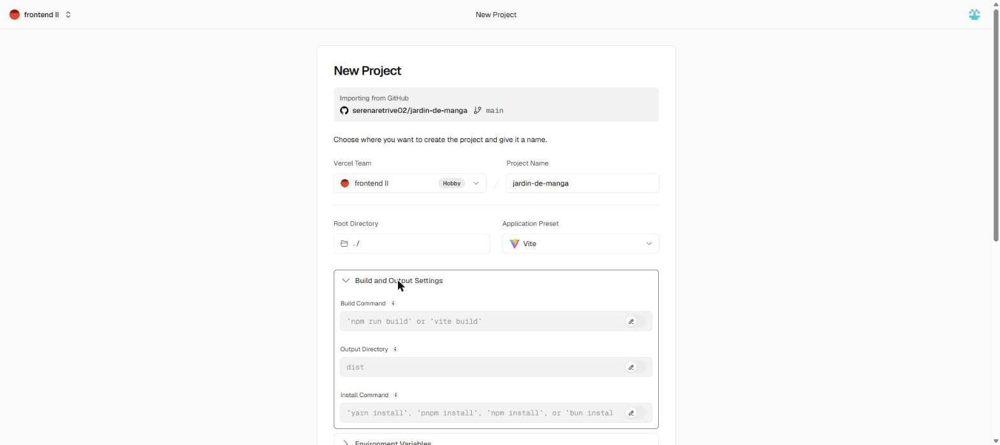
*Captura 8: Vercel detecta Vite, `npm run build` y la carpeta `dist`.*

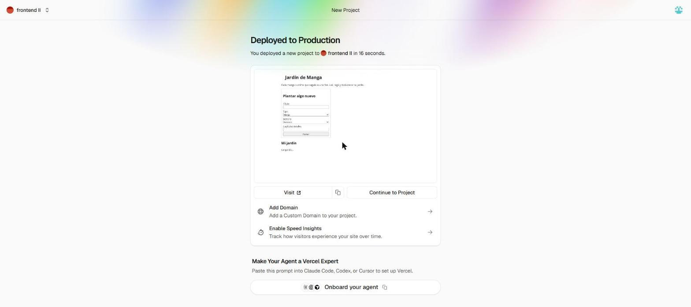
*Captura 9: "Deployed to Production". La vista previa ya muestra la app.*

**URL publicada:** https://jardin-de-manga.vercel.app

### Pruebas en la versión publicada (10/11/2026)
Se repitieron las pruebas desde la URL de Vercel (paso 8 de la consigna):

| Prueba | Resultado |
|---|---|
| La app abre y se conecta a Firebase | ✅ Muestra "Tu jardín está vacío" sin errores |
| Agregar "Spy x Family" (anime, comedia, 12 capítulos) | ✅ Aparece como 🫘 semilla |
| +1 capítulo y estado "Terminado" | ✅ Pasa a 🌼 "En flor" |
| Recargar la página | ✅ Sigue en flor, 1/12, terminado |
| Agregar y eliminar "Prueba para borrar" | ✅ Desaparece y no vuelve al recargar |
| Pantalla de compu (1280 px) | ✅ Se usa bien (captura 10) |
| Pantalla de celular (390 px) | ✅ Se puede usar, pero con detalles para mejorar (captura 11) |

> **Algo que llamó la atención:** en la versión publicada el jardín empezó vacío, aunque en local ya había un manga plantado. No es un error: el acceso es anónimo, y Firebase toma a `localhost` y a `vercel.app` como dos visitantes distintos, así que cada uno tiene su propio jardín. La consigna lo explica en la etapa 4.

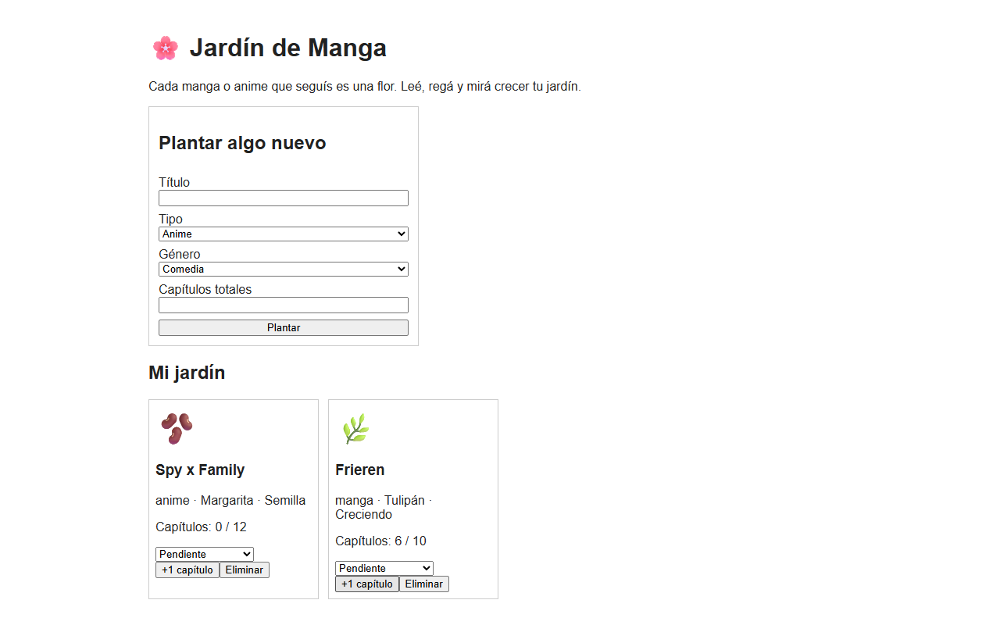
*Captura 10: la versión 0.1 publicada en Vercel, vista en compu.*

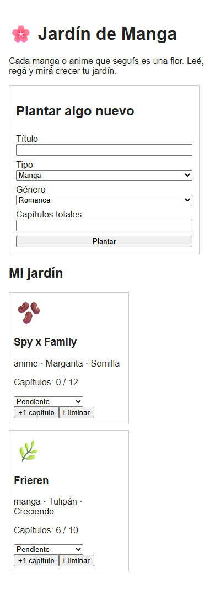
*Captura 11: la misma versión en un celular (390 px de ancho).*

### Un error al actualizar el repositorio (y cómo se corrigió)
Al subir la documentación final de la v0.1, **el archivo `.env.example` se borró del repositorio**. Al preparar el `.env`, el archivo de ejemplo se había renombrado en lugar de copiarse. Git interpretó que se había eliminado y el commit subió esa eliminación.

- **Cómo se detectó:** revisando la lista de cambios del commit (`git status`), donde aparecía `D .env.example` (D = *deleted*, eliminado).
- **Cómo se resolvió:** se recuperó el archivo desde un commit anterior y se subió de nuevo con un commit nuevo ("fix: restaurar .env.example").
- **Verificación:** en GitHub `.env.example` vuelve a estar disponible y `.env` sigue sin publicarse.
- **Aprendizaje:** el archivo `.env` se crea **copiando** `.env.example`, no renombrándolo. Y conviene leer siempre la lista de cambios antes de cada commit, no solo la primera vez.

### Conclusión de la v0.1
**La v0.1 cumple el mínimo de la consigna:** está hecha con React + Vite, guarda, consulta, modifica y elimina en Firestore, conserva los cambios al recargar, tiene reglas de seguridad, el código está en GitHub sin las llaves y está publicada en Vercel.

### Mejoras detectadas para la v0.2
Lo que se observó al probar esta versión y que se va a trabajar en la próxima:
1. **Identidad visual:** hoy parece un formulario de los 2000. Hace falta una paleta, tipografía e ilustraciones que transmitan "jardín" y "manga".
2. **Celular:** las tarjetas miden 200 px fijos y dejan espacio vacío. Los botones son muy chicos para tocar con el dedo.
3. **Botones que se mueven:** cuando el texto pasa a dos líneas, los botones cambian de lugar.
4. **Mensajes:** no hay confirmación de "¡Plantado!" ni de "Guardado". Solo se ven los errores.
5. **Validaciones:** el título solo se controla como "obligatorio". Faltan avisos claros, por ejemplo para un título muy largo o capítulos negativos.
6. **Eliminar sin confirmar:** un clic por error borra la planta.
7. **Coherencia de datos:** se puede marcar "Terminado" con 1 de 12 capítulos, o sumar capítulos por encima del total.
8. **Emojis:** dependen del sistema de cada dispositivo. Ilustraciones propias darían un diseño más cuidado y coherente.

---

## Versión 0.2 — Identidad visual pixel art y mejor experiencia de uso (10/11/2026)

### Objetivo de esta versión
Resolver las mejoras que quedaron anotadas al probar la v0.1. Sobre todo, que la app **tenga identidad propia** y **se use cómodamente en el celular**. En esta versión no se agregan datos nuevos a Firebase: se mejora cómo se ven y cómo se usan los que ya existen.

### Decisión de diseño: ¿por qué pixel art?
- **Conecta con el público y con mis gustos.** La estética de videojuego retro (Minecraft, juegos de 8 bits) es familiar para quienes leen manga y miran anime. Convierte "registrar capítulos" en algo parecido a cuidar plantas en un juego.
- **Refuerza la metáfora del jardín.** Cada planta es un pequeño personaje que cambia a medida que avanzás. El pixel art permite dibujar esas etapas de forma simple y reconocible.
- **Es coherente.** Todo (flores, íconos, botones, sombras, tipografía) sigue la misma regla: bordes oscuros, colores planos y sombras "duras" sin difuminar.

**Referencias visuales que se usaron** (imágenes de inspiración, no son propias):

| Referencia | Qué se tomó |
|---|---|
| 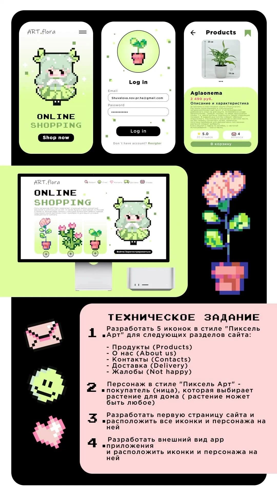 | Paleta **verde lima + rosa pastel** y flores en maceta pixeladas |
| 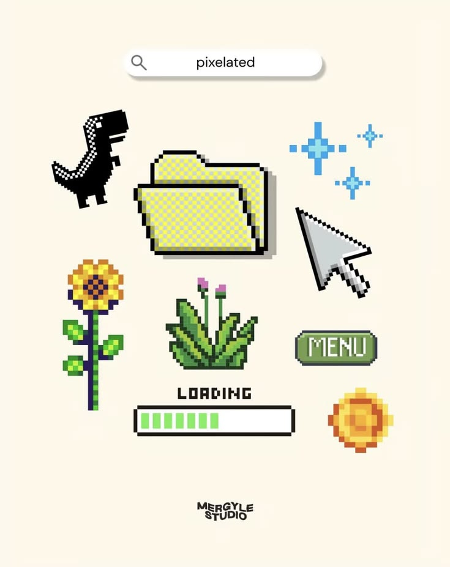 | Íconos con contorno negro y barra de "LOADING" por bloques |
| 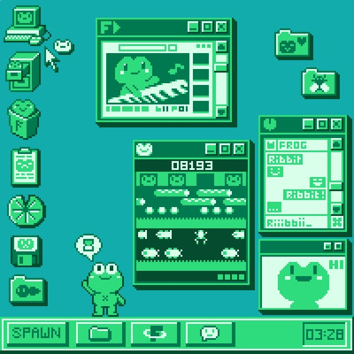 | **Ventanas de computadora retro** con barra de título y botones `_ □ ×` |

### Sistema visual definido
| Elemento | Decisión | Por qué |
|---|---|---|
| Colores | Lima `#D7F59A` (principal), rosa `#F9C6CF` (acento), contorno `#1E2B1F`, fondo crema `#FFFBEF` | Pastel y alegre, con buen contraste gracias al contorno oscuro |
| Tipografías | **Press Start 2P** para títulos y **Pixelify Sans** para textos (Google Fonts) | La primera es muy "arcade", pero cuesta leerla en textos largos. Por eso se usa solo en títulos |
| Bordes y sombras | Bordes de 3 px y sombras sólidas de 4 px | Imitan los píxeles: nada difuminado |
| Ventanas | El formulario es `plantar.exe` y el jardín es `mi_jardin.exe` | Cada sección parece un "programa" de una compu retro |
| Fondo | Cuadrícula de puntitos | Recuerda al papel cuadriculado donde se dibuja pixel art |

### Las flores, dibujadas con código
Las flores **no son imágenes descargadas**: se dibujaron a mano como **grillas de letras**. Cada dibujo es un *array* de 16 textos de 16 letras, y cada letra es un píxel de un color. El componente `PixelSprite` recorre ese array con **`map`** (las filas) y otro **`map`** (las letras), y dibuja un cuadradito por cada letra. Así se aplica lo visto en la guía de *Arrays, map y filter*.

```
'.....KK..KK.....'     K = contorno
'....KPPKKPPK....'     P = pétalo (cambia según el género)
'...KPPWPPPPpK...'     C = centro de la flor
'...KPPPCCPPpK...'     G = tallo, H = hoja
```

La flor es **una sola grilla**, y cada género le cambia los colores de los pétalos y del centro (rosa, girasol, tulipán violeta, margarita, cerezo e hibisco). Así, con 5 dibujos (semilla, brote, creciendo, flor y marchita) se obtienen 10 apariencias distintas.

**Iteración del dibujo:** en el primer boceto la flor parecía una mancha redonda y el ícono de "pala" no se entendía. Se le marcaron pétalos con muescas y la pala se cambió por un tacho de compost.

| Primer boceto | Versión final |
|---|---|
| 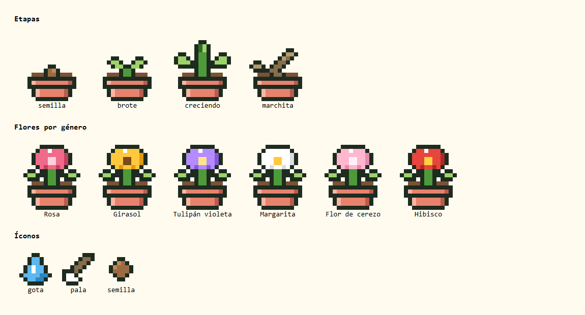 | 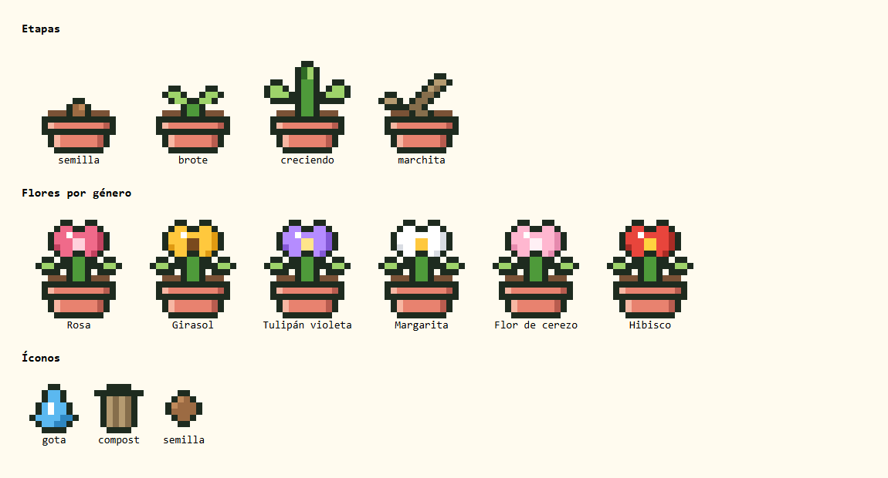 |

### Cambios en la experiencia de uso
| Problema de la v0.1 | Solución en la v0.2 |
|---|---|
| Los botones cambiaban de lugar según el largo del texto | Los títulos ocupan como máximo 2 líneas y las acciones quedan siempre al final de la tarjeta |
| Botones chicos en el celular | Todos los botones miden al menos 44 px de alto, el tamaño recomendado para tocar con el dedo |
| No había mensajes de éxito | Aparece un **aviso flotante** ("Plantaste…", "Regaste… (3 cap.)", "…volvió a la tierra") que se cierra solo |
| Validación mínima | Mensajes debajo de cada campo: título vacío o muy largo (máx. 120), capítulos negativos o con decimales. Se muestra un contador "0 / 120" |
| Se borraba sin confirmar | El botón de compost pregunta **"¿Compostar esta planta?" Sí / No** dentro de la misma tarjeta |
| Se podían sumar capítulos sin límite | Al llegar al total, el botón cambia a **"Completo"** y se desactiva |
| "Cargando..." era un texto plano | **Barra de carga por bloques**, como en los videojuegos |
| No se veía el avance | **Barra de progreso** de 10 bloques en cada tarjeta |
| — | **Vista previa** en el formulario: muestra qué flor vas a obtener según el género elegido |
| — | En anime dice "episodios" en lugar de "capítulos" |
| — | Pie de página con el código de la "jardinera anónima", que ayuda a explicar el acceso anónimo |

### Antes y después
| v0.1 | v0.2 |
|---|---|
|  |  |

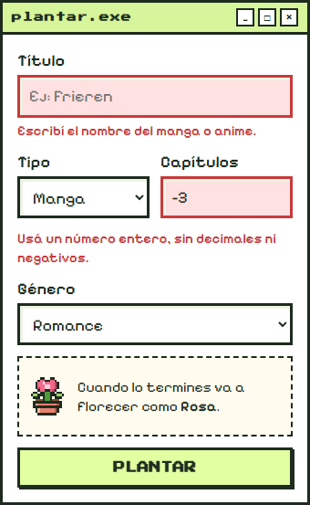
*Captura: los errores del formulario se marcan en rojo, debajo de cada campo.*


*Captura: aviso de éxito después de plantar.*

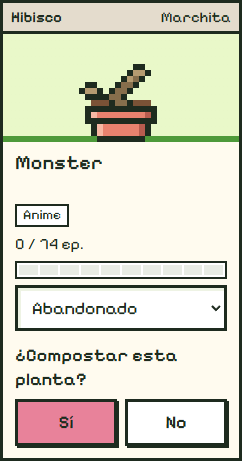
*Captura: antes de eliminar, la tarjeta pide confirmación.*

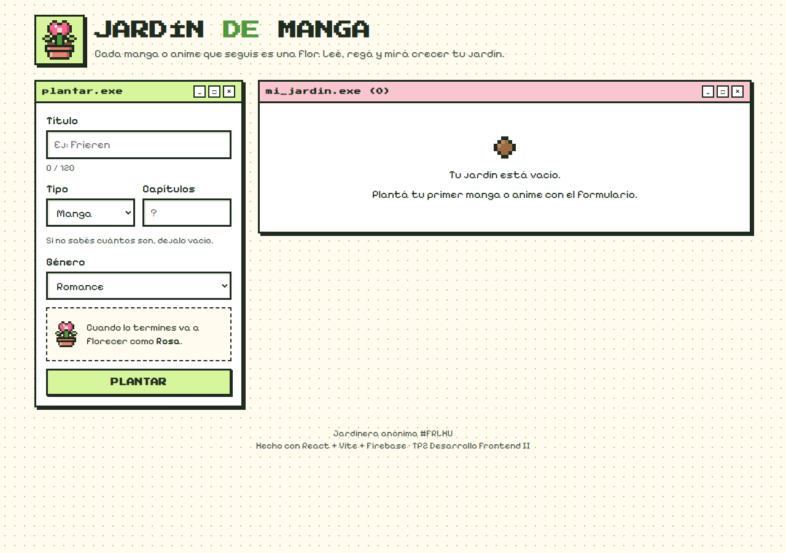
*Captura: así se ve el jardín cuando todavía no hay plantas.*

### Diseño para celular: una iteración dentro de la versión
El primer intento para celular ponía **2 plantas por fila**. Al probarlo en una pantalla de 390 px, el texto del estado se cortaba ("Abandono…") y el botón de compost caía a otra línea. Se rediseñó: en el celular cada tarjeta es **horizontal**, con la maceta a la izquierda y los datos a la derecha, una planta por fila.

| Primer intento (descartado) | Versión final |
|---|---|
| 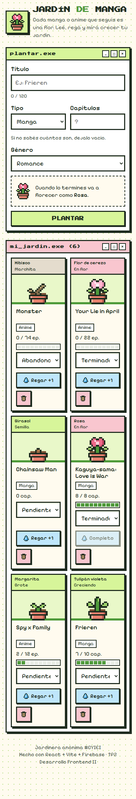 |  |

### Uso de IA en esta etapa
- **Instrucción dada:** *"Vayamos con la 0.2. Me gustaría que el diseño sea tipo pixel art si se puede"*, junto con tres imágenes de referencia.
- **Qué hizo la IA:** propuso dibujar las flores como grillas de texto en lugar de usar imágenes, definió la paleta a partir de las referencias, escribió los componentes y probó la app con un navegador automático.
- **Qué revisé y corregí:** las capturas en compu y en celular. A partir de esa revisión se rehicieron el dibujo de la flor, el diseño para celular y el problema de la tipografía.

### Dificultades y cómo se resolvieron
| Problema | Cómo se detectó | Solución |
|---|---|---|
| La fuente Pixelify Sans dibuja "fl" como un solo símbolo y **"flor" se leía "Aor"** | Mirando la captura del formulario ("va a Aorecer") | Se desactivaron las ligaduras tipográficas con `font-variant-ligatures: none` |
| En el celular, con 2 columnas, los textos se cortaban | Captura automática a 390 px de ancho | Tarjetas horizontales de una columna (ver arriba) |
| El primer dibujo de la flor no se reconocía | Mirando la "hoja de sprites" | Pétalos con muescas y brillo blanco |
| El aviso flotante podía reiniciar su temporizador en cada render | Revisando el código del efecto | Se le pasa el *setter* `setAviso`, que no cambia entre renders. Así el `useEffect` solo se reinicia cuando llega un aviso nuevo (y limpia el anterior con `clearTimeout`) |

### Pruebas realizadas (en local, con un navegador automático)
| Prueba | Resultado |
|---|---|
| Enviar el formulario sin título y con capítulos en −3 | ✅ Aparecen los dos mensajes de error y no se guarda nada |
| Plantar 6 títulos de distintos géneros | ✅ Aviso de éxito en cada uno |
| Regar hasta el total | ✅ El botón pasa a "Completo" y se desactiva |
| Cambiar estados (terminado, abandonado) | ✅ La flor florece o se marchita |
| Recargar la página | ✅ Todo sigue igual: los datos están en Firestore |
| Pedir compostar | ✅ Pregunta antes de borrar |
| Celular (390 px) | ✅ Sin desplazamiento horizontal y con todo legible |
| Errores en la consola del navegador | ✅ Ninguno |

### Publicación y verificación en Vercel
1. Se revisó la lista de cambios antes del commit (aprendizaje de la v0.1): no había archivos borrados ni `.env`.
2. Se subió a GitHub con la etiqueta **`v0.2`**.
3. **Vercel publicó la versión solo**, sin tocar nada: el deploy apareció como *Ready* a los 6 segundos.
4. Se repitieron **todas las pruebas sobre la URL pública** (validaciones, plantar, regar, estados, recargar, confirmar borrado y celular): todas pasaron y no hubo errores en la consola.

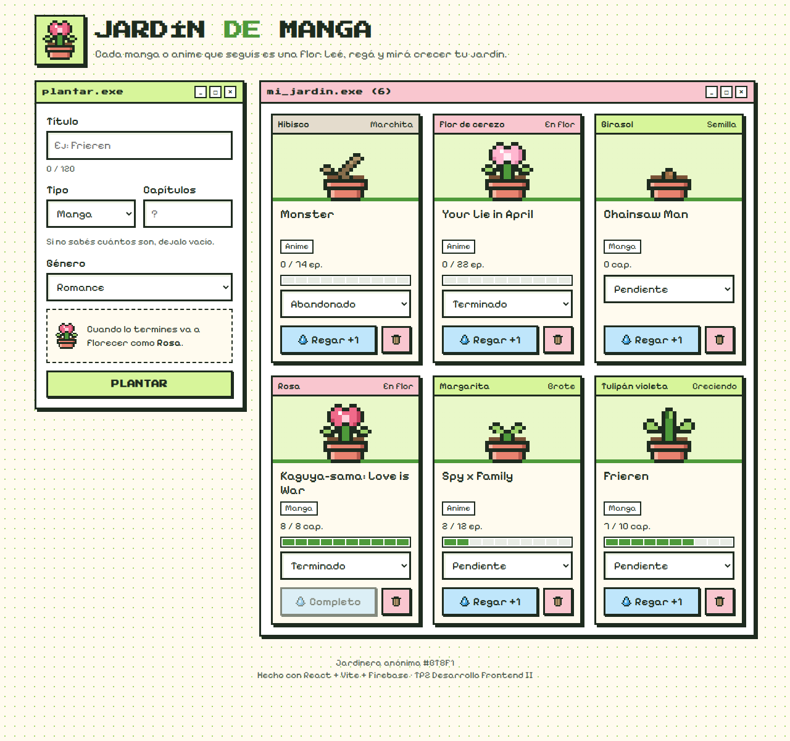
*Captura: la v0.2 funcionando en https://jardin-de-manga.vercel.app*

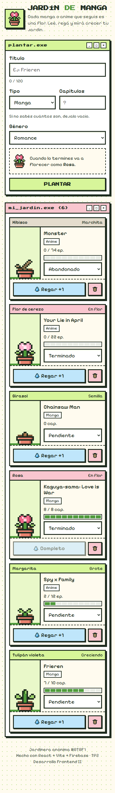
*Captura: la v0.2 publicada, vista en celular.*

### Mejoras pendientes para la v0.3
- La fuente de títulos (*Press Start 2P*) no tiene la letra **"Í" mayúscula**, por eso el título se ve "JARDíN". Hay que resolverlo.
- Hoy se puede marcar "Terminado" con 0 capítulos leídos (por ejemplo, *Your Lie in April*: 0/22 y en flor). Habría que ofrecer completar los capítulos.
- Buscar mangas y animes reales con una **API** (portada, sinopsis y cantidad de capítulos automática), usando `fetch` como en la guía de APIs.
- Poder **editar** el título, el género o el total de capítulos de una planta ya plantada.
- Marcar automáticamente "Terminado" al llegar al último capítulo.

---

## Versión 0.3 — Nombre nuevo, búsqueda con API y edición (10/11/2026)

### Objetivo de esta versión
Sumar **funcionalidades nuevas**: buscar obras reales en internet, editar plantas y hacer que el estado de cada planta sea coherente con los capítulos. Además, la app pasa a llamarse **Nana**.

### La app ahora se llama "Nana"
- "Jardín de Manga" era un nombre provisorio y descriptivo. **Nana** es corto, fácil de recordar y suena a ***hana*** (花), que en japonés significa "flor". Une las dos ideas de la app: el manga y las flores.
- "Tu jardín de manga" queda como **subtítulo**, para que se entienda de qué se trata.
- **Además resolvió un problema pendiente:** la fuente de títulos no tenía la "Í" mayúscula ("JARDíN"). "NANA" no lleva tilde, y los textos con tilde que usaban esa fuente (como "Cargando jardín…") pasaron a la fuente Pixelify Sans, que sí tiene todas las letras.
- El repositorio y la URL siguen siendo `jardin-de-manga`. Cambiarlos rompería los enlaces que ya funcionan.

### Nueva función: buscar mangas y animes reales (API)
En el formulario ahora se elige **Manga** o **Anime**, se escribe un nombre y se toca **Buscar**. La app consulta una **API pública** y muestra hasta 6 resultados con portada, año, cantidad de capítulos y la flor sugerida. Al elegir uno, **se completan solos** el título, los capítulos y el género, y se pueden corregir a mano.

**Cómo funciona (lo visto en la guía de APIs):**
1. Con `fetch` se hace un pedido GET a una dirección como `https://kitsu.io/api/edge/manga?filter[text]=frieren`.
2. Se revisa `respuesta.ok` (fetch no falla solo con un error 404 o 500) y se lee el JSON con `respuesta.json()`.
3. Los resultados vienen en `datos.data`. Esta API usa el nombre `data`, no `message` como la Dog CEO de clase: hay que leer la documentación de cada API.
4. Se transforman con **`map`** en objetos simples. Con **`filter`** se descartan las categorías vacías, con **`forEach`** se arma un diccionario de categorías y con **`find`** se elige la flor que corresponde.
5. La consulta se hace al tocar **Buscar** (un evento) y no en cada letra, para no hacer pedidos de más ni chocar con el límite de consultas.
6. Hay estados de **carga** ("Buscando en Kitsu..."), **error** ("No se pudo consultar la API. Podés completar los datos a mano") y **sin resultados**. Si el error es el 429 (demasiadas consultas), se pide esperar unos segundos.

**Cómo se elige la flor a partir de la API:** Kitsu devuelve categorías en inglés ("Romance", "Fantasy", "Action"…). Una tabla las relaciona con nuestros géneros, en orden de prioridad: romance → fantasía → acción → misterio → comedia → drama. Por ejemplo, *Spy x Family* (Action, Comedy…) se sugiere como **girasol** (acción).

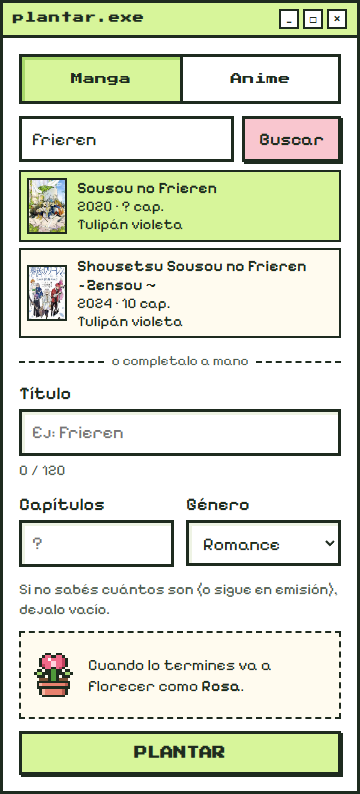
*Captura: resultados de la búsqueda "frieren", con portada, año, capítulos y la flor sugerida.*

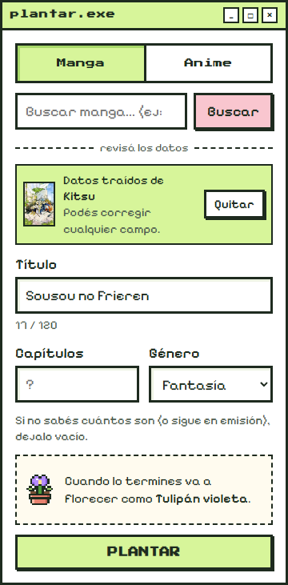
*Captura: al elegir un resultado se completan los campos y se avisa que los datos vienen de Kitsu.*

### Dificultad: la API que habíamos planeado estaba caída
El plan original era usar **Jikan**, una API gratuita que toma los datos de MyAnimeList.

| Paso | Qué se hizo | Resultado |
|---|---|---|
| 1 | Se consultó Jikan desde la terminal | *Connection timed out* (no respondía) |
| 2 | Se probó en el navegador con `fetch` | `TypeError: Failed to fetch` |
| 3 | Se comprobó que otras páginas sí respondían | GitHub respondía bien: el problema era Jikan, no la conexión |
| 4 | Se probaron dos alternativas gratuitas y sin clave: **Kitsu** y **AniList** | Las dos respondieron (código 200) |
| 5 | Se eligió **Kitsu** | Funciona igual que lo visto en clase: una URL con `fetch` (GET) que devuelve JSON. AniList usa GraphQL, un sistema que no vimos en la materia |

**Aprendizaje:** una app que depende de un servicio externo tiene que funcionar aunque ese servicio falle. Por eso la búsqueda es **una ayuda opcional**: si la API no responde, se avisa y se puede completar todo a mano.

### Nueva función: editar una planta
Cada tarjeta tiene un botón con un **lápiz pixelado** que abre la ventana **`editar.exe`**. Desde ahí se cambian el título, el género (y con él, la flor), los capítulos vistos y el total.
- Valida igual que el formulario de plantar y además **no deja poner más capítulos vistos que el total**.
- Se cierra con *Cancelar*, con la tecla *Escape* o tocando afuera.

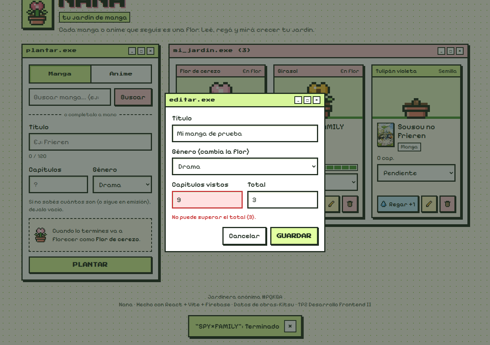
*Captura: la ventana de edición avisa que los capítulos vistos no pueden superar el total.*

### Estados coherentes con los capítulos
| Situación | Antes (v0.2) | Ahora (v0.3) |
|---|---|---|
| Regar por primera vez una planta "Pendiente" | Seguía "Pendiente" | Pasa a **"Leyendo"** |
| Regar el último capítulo | Solo se bloqueaba el botón | **Florece sola** (Terminado) con el aviso "¡…floreció! Lo terminaste" |
| Marcar "Terminado" con capítulos pendientes | Quedaba "en flor" con 0/22 | **Completa los capítulos** automáticamente |
| Editar y agregar capítulos a algo "Terminado" | — | Vuelve a **"Leyendo"** |


### Base de datos: campos nuevos y reglas más estrictas
Cada planta puede guardar dos datos nuevos (solo si vino de la búsqueda):
- `portada`: la dirección de la imagen de tapa;
- `kitsuId`: el número de la obra en Kitsu.

Se actualizaron las **reglas de Firestore** y se publicaron de nuevo en la consola de Firebase (desplegar en Vercel no las actualiza):
- **Solo se aceptan los campos conocidos** (`hasOnly`). Si alguien intenta guardar un campo inventado, Firebase lo rechaza.
- La portada tiene que ser un enlace que empiece con `https://`.
- Los capítulos leídos **no pueden superar el total**. Ahora lo controla también la base de datos, no solo la interfaz.

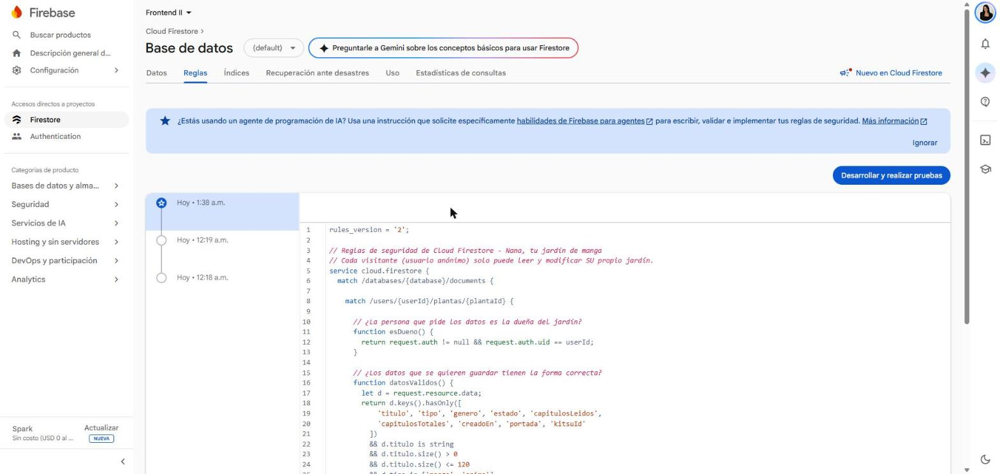
*Captura: reglas publicadas. A la izquierda se ve la versión nueva (1:38) junto a las anteriores.*

### Uso de IA en esta etapa
- **Instrucción dada:** *"Sí [seguimos con la v0.3]. Cambiemos el título a Nana."*
- **Qué hizo la IA:** investigó por qué Jikan no respondía y comparó alternativas, escribió el servicio de búsqueda, la edición y las reglas nuevas, y armó una prueba automática de 17 pasos.
- **Qué se revisó:** las capturas de cada prueba. Gracias a eso se encontraron los errores de la tabla siguiente.

### Dificultades y cómo se resolvieron
| Problema | Cómo se detectó | Solución |
|---|---|---|
| La API Jikan no respondía | Pruebas desde la terminal y desde el navegador | Se cambió a Kitsu (ver arriba) |
| Si una obra de Kitsu no tiene portada, se mandaba un texto vacío y **la regla nueva lo rechazaba** | Releyendo las reglas mientras se publicaban | La portada solo se guarda si existe |
| En el celular, el formulario **se salía de la pantalla** (409 px en una pantalla de 390 px) | La prueba automática de "sin desplazamiento horizontal" falló. Un diagnóstico mostró que era la ventana `plantar.exe` | En CSS Grid, `1fr` no deja que una columna sea más angosta que su contenido. Se cambió por `minmax(0, 1fr)` |
| Al editar el total de una planta "en flor", seguía en flor con 9/12 | Mirando la captura del jardín después de editar | Al guardar una edición se recalcula el estado |
| Con el botón de editar, el de compost bajaba a otra línea | Captura de la compu | Los tres botones quedan en una fila y "Regar" se adapta al espacio |
| El texto de ejemplo del buscador se cortaba en el celular | Captura del celular | Se acortó a "Ej: Frieren" |
| La prueba automática apretaba "Buscar" en vez de "Plantar" | La prueba se quedaba esperando | Había dos botones de envío. Se indicó cuál era el del formulario. Era un problema de la prueba, no de la app |

| Antes | Después |
|---|---|
| 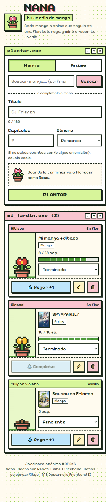 |  |

### Pruebas realizadas (en local, prueba automática de 17 pasos)
| Prueba | Resultado |
|---|---|
| El título dice NANA | ✅ |
| Buscar "frieren" en Kitsu devuelve resultados | ✅ |
| Al elegir, se completan el título y el aviso "Datos traídos de Kitsu" | ✅ |
| La tarjeta muestra la portada | ✅ |
| Buscar el anime "spy x family": completa 12 episodios y sugiere girasol (acción) | ✅ |
| Regar por primera vez pasa a "Leyendo" | ✅ |
| Regar el último capítulo hace florecer la planta | ✅ |
| Marcar "Terminado" completa los episodios (12/12) | ✅ |
| Editar no deja poner 9 capítulos vistos de un total de 3 | ✅ |
| Editar guarda el título, el total y el género, y cierra la ventana | ✅ |
| Después de editar el total, la planta vuelve a "Leyendo" | ✅ |
| Después de recargar, todo sigue igual (incluidas las portadas) | ✅ |
| Celular de 390 px sin desplazamiento horizontal | ✅ |
| Errores en la consola | ✅ Ninguno |

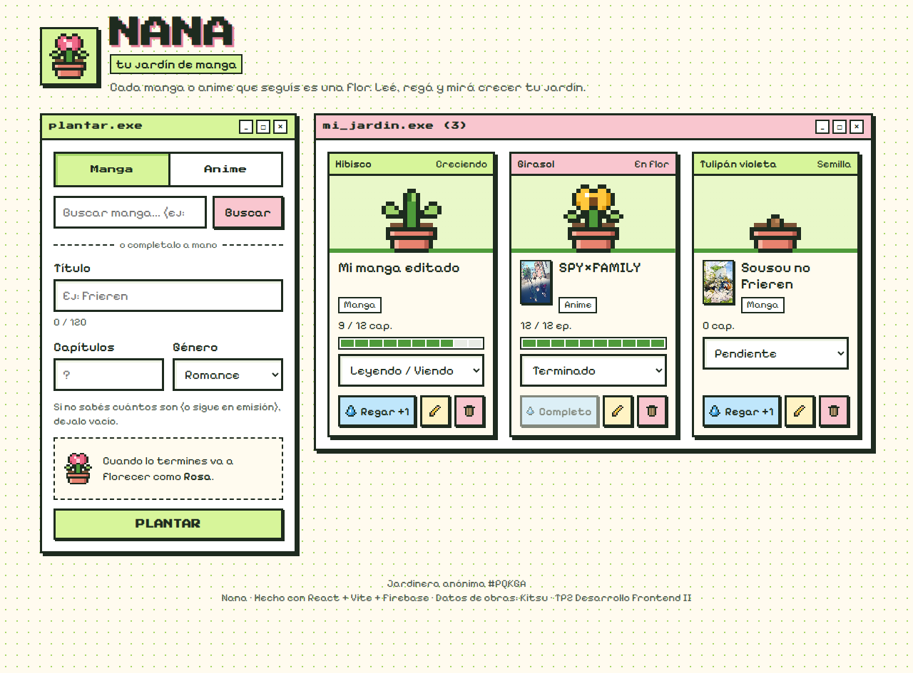
*Captura: la v0.3 en la compu, con portadas, botón de editar y estados coherentes.*

### Publicación y verificación en Vercel
1. **Primero se publicaron las reglas nuevas en Firebase y después el código.** En el orden inverso, la versión publicada habría intentado guardar portadas que las reglas viejas rechazaban.
2. Se revisó la lista de cambios (24 archivos, sin borrados ni `.env`) y se subió con la etiqueta **`v0.3`**.
3. Vercel publicó la versión solo, en 5 segundos (*Ready*).
4. Se repitió la **prueba automática de 17 pasos sobre la URL pública**: 17/17 correctas y ningún error en la consola.


*Captura: la v0.3 funcionando en https://jardin-de-manga.vercel.app*

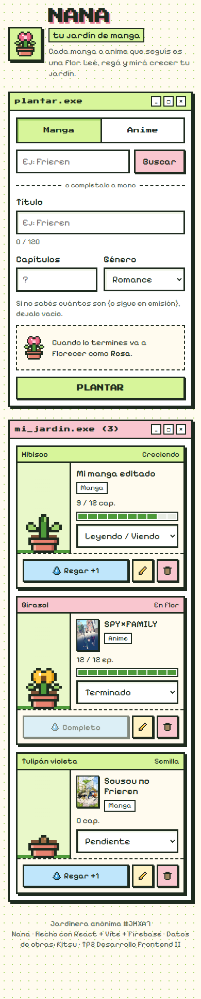
*Captura: la v0.3 publicada, vista en celular.*

### Ideas para la v0.4
- **Buscar y filtrar dentro del jardín** (por estado, género o nombre), aplicando `filter` como en la guía.
- **"Mi ramo"**: estadísticas del jardín (cuántas flores, capítulos leídos en total, género favorito).
- **Significado de cada flor** según el *hanakotoba* (el lenguaje japonés de las flores).
- Ordenar el jardín (más recientes, por avance, por nombre).

---

## Versión 0.4 — Comunidad: clubes, misiones con roles y eventos (10/11/2026)

### Revisión previa: ¿cumplimos la consigna y la rúbrica?
Antes de empezar se revisó el proyecto contra cada punto de la consigna y de la rúbrica:

| Criterio | Estado |
|---|---|
| A · React + Vite con interacciones | ✅ |
| A · Firebase: consultar, agregar, modificar, eliminar y persistir | ✅ |
| A · GitHub con los archivos para ejecutar | ✅ 31 archivos. `.gitignore` excluye `.env`, `node_modules` y `dist`. Ninguna llave en el código |
| A · Vercel con conexión a Firebase | ✅ |
| B · README, `.env.example`, reglas, informe con IA y dificultades | ✅ |
| B · Entrega organizada con enlaces | ⚠️ Faltaba un documento de entrega → se creó [`entrega.md`](entrega.md) |
| C · Originalidad y complejidad | Se refuerza en esta versión con la comunidad |
| Al menos 3 versiones | ✅ v0.1, v0.2, v0.3 (con etiquetas en GitHub) |
| Mini video de demostración | ⏳ Pendiente (lo graba la autora) |

### Objetivo de esta versión
La app era solo un registro personal: plantar, regar y nada más. Para darle una **vuelta de tuerca** y **sumar acciones con sentido**, Nana pasa a ser también una **comunidad de lectura**. Siguiendo lo trabajado en clase (diagrama de casos de uso y requisitos), se definieron:
- **CRUD de grupos:** clubes de lectura.
- **CRUD de tareas de distintos tipos:** misiones (leer, ver episodios, reseña, fan art, teoría, recomendar).
- **Requisito de rol:** la administradora es el único rol que puede asignar tareas.
- **CRUD de eventos:** lecturas conjuntas, watch parties, debates, intercambios.
- **Compartir** tareas, eventos e invitaciones.

El detalle (requisitos, criterios de aceptación y diagrama de casos de uso) está en [`especificacion.md`](especificacion.md).

### Cómo funciona (explicado simple)
1. **Perfil:** la primera vez que se entra a **Comunidad**, se elige un **apodo** y una **flor-avatar**.
2. **Crear un club:** quien lo crea es su **administradora**. Cada club tiene un **código de 6 letras** (por ejemplo `DAAUN4`).
3. **Invitar:** el botón *Invitar ↗* abre el menú de compartir del celular (o copia el texto en la compu) con un enlace como `…vercel.app/?club=DAAUN4`. Al abrirlo, la app va directo a Comunidad con el código ya escrito.
4. **Misiones (tareas):** la administradora crea una misión, elige el **tipo**, se la **asigna** a un miembro y puede ponerle fecha límite. Se ven en un **tablero Kanban** con tres columnas: *Por hacer · Haciendo · Hecha*. Cada persona mueve **solo sus** misiones. Las vencidas se marcan en rojo.
5. **Eventos:** cualquier miembro propone uno (fecha, lugar o enlace, descripción). Los demás tocan **¡Voy!** y se ve quiénes van. Los eventos pasados se muestran aparte y atenuados.
6. **Salir o eliminar:** un miembro puede salir del club. La administradora puede quitar miembros o eliminar el club entero, junto con sus misiones y eventos.

### El requisito más importante: solo la administradora asigna tareas
No alcanza con **esconder el botón**: alguien con conocimientos podría mandar el pedido directo a Firebase. Por eso la regla se aplica **en dos lugares**:
- **En la interfaz:** los miembros no ven "+ Nueva misión", y en su lugar dice "Solo la administradora asigna misiones".
- **En las reglas de Firestore:** solo quien figura como `adminUid` del club puede crear, editar o borrar misiones. La persona asignada solo puede cambiar el campo `estado` de **su** misión.

**Prueba de seguridad:** se simuló a una usuaria (Bea, miembro) que intenta crear una misión y cambiar el nombre del club **llamando directamente a la API de Firestore**, sin pasar por la app. Firebase respondió **403 (prohibido)** en los dos casos ✅.

Las reglas también controlan que:
- para unirse, solo se pueda **agregar el propio** usuario a la lista de miembros, y para salir, solo **sacarse a una misma**;
- para anotarse a un evento, solo se pueda tocar **el propio nombre** en la lista de asistentes;
- los clubes solo los puedan ver **sus miembros** (máximo 30), y todos los datos tengan la forma correcta.

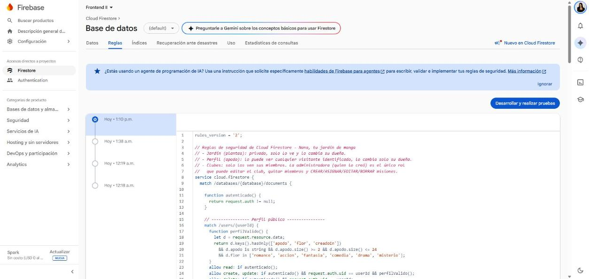
*Captura: reglas publicadas en Firebase (versión de las 13:10).*

### Capturas

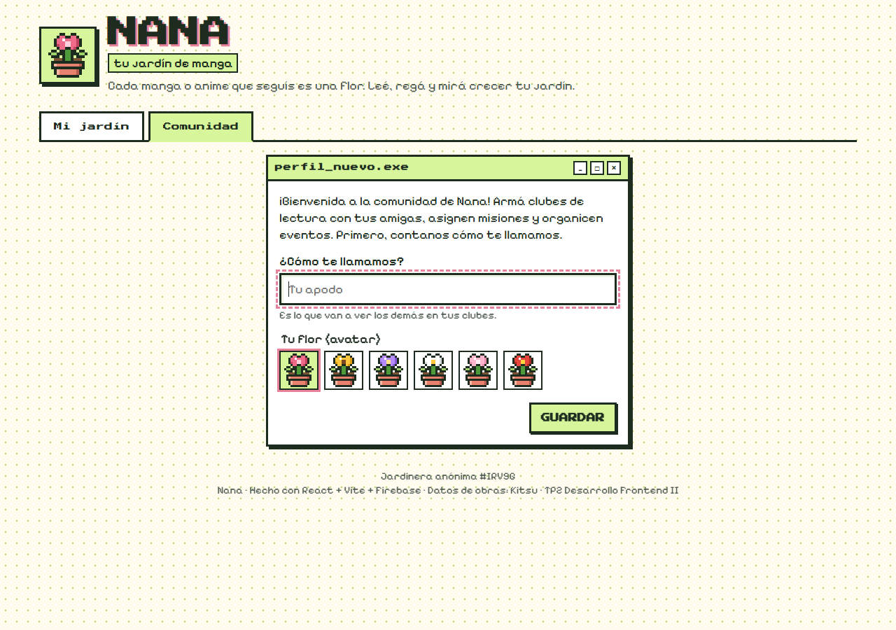
*La primera vez se elige un apodo y una flor-avatar.*


*El club visto por la administradora: código e invitación, miembros con su insignia y tablero de misiones de distintos tipos.*

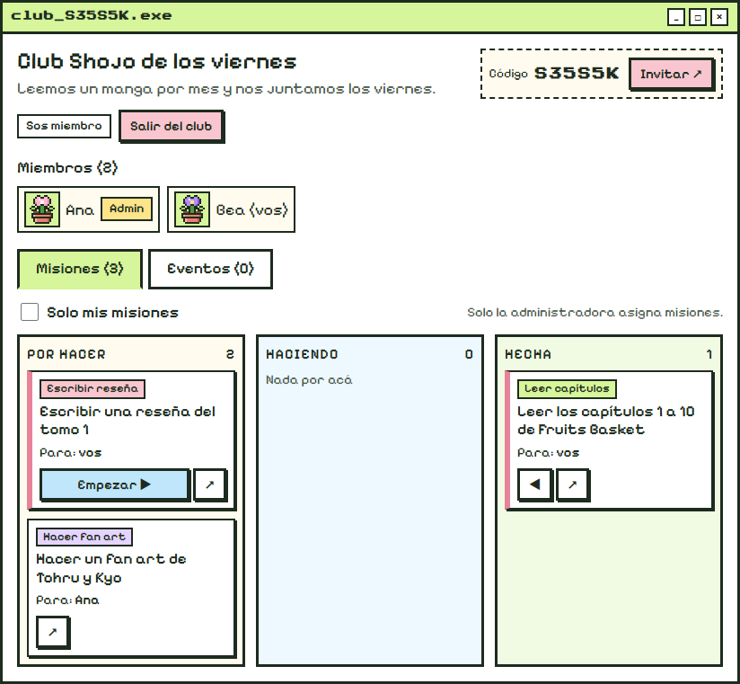
*El mismo club visto por Bea (miembro): no puede asignar misiones, pero mueve las suyas (marcadas con un borde rosa).*

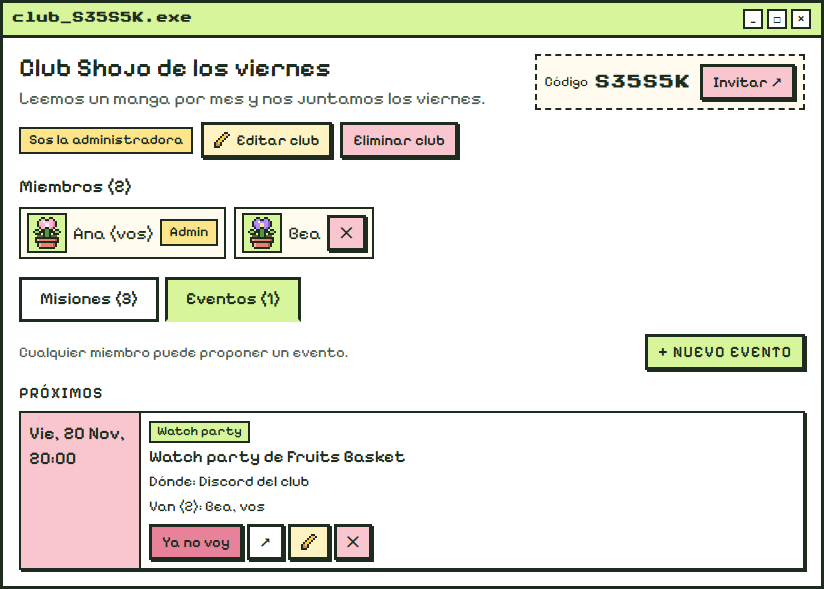
*Eventos: Bea propuso una watch party y Ana se anotó.*

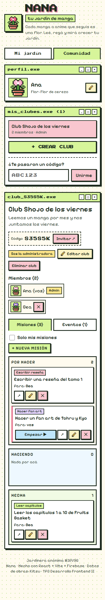
*La comunidad en el celular: todo en una columna y el tablero apilado.*

### Uso de IA en esta etapa
- **Instrucción dada (resumen):** *"Chequeá que se cumpla todo lo que pide la consigna y la rúbrica para sacarnos un 10. Quiero sumar más acciones: una comunidad, añadir amigos o grupos de lectura. Que el usuario pueda crear, modificar, eliminar y compartir tareas; CRUD de eventos y de grupos; tareas de distintos tipos; el administrador es el único rol que puede asignar tareas; distintos tipos de iteraciones ágiles."*
- **Qué hizo la IA:** auditó el repositorio contra la rúbrica, diseñó el modelo de datos y las reglas por rol, programó 4 servicios y 12 componentes nuevos, y armó una prueba automática con **dos usuarias simultáneas**.
- **Qué se revisó y se corrigió** a partir de las capturas y las pruebas: los 7 problemas de la tabla siguiente.
- **Decisión propia:** en lugar de una lista de "amigos" sueltos, la comunidad se organiza en **clubes**. Cumple la misma necesidad (leer con amigas), es más fácil de entender y permite roles claros.

### Dificultades y cómo se resolvieron
| Problema | Cómo se detectó | Solución |
|---|---|---|
| **Cómo unirse a un club sin poder verlo antes.** Las reglas solo dejan ver un club a sus miembros | Al diseñar las reglas | El **código es el id del documento**: para unirse alcanza con conocerlo. Las reglas permiten un solo cambio: agregarse a una misma |
| El aviso "Misión actualizada" aparecía **antes** de que el tablero mostrara el cambio | La prueba automática leía el tablero viejo | Ahora primero se vuelven a consultar las misiones y eventos, y **recién después** se avisa |
| Un evento de esta noche podía figurar como "pasado" 3 horas antes | Revisando el código de fechas | `toISOString()` da la hora UTC (Londres). Se calcula la hora **local** de Argentina |
| "+ NUEVA MISIÓN" y "PRÓXIMOS" se veían con la Ó minúscula | Captura del primer diseño | La fuente arcade no tiene vocales con tilde en mayúscula. Esos textos usan Pixelify Sans |
| Mucho espacio vacío dentro de cada misión | Captura del primer diseño | Los subtítulos `h4` y `h5` traían márgenes por defecto. Se quitaron |
| El lápiz "✎" se veía como una barra "\" | Captura | Se reemplazó por el lápiz pixelado del jardín |
| El navegador de pruebas (Edge) dejó de abrir después de una actualización | Error "Failed to launch the browser" | Se usó Chrome. Para simular dos usuarias se usaron **dos ventanas de incógnito**, que Firebase ve como dos visitantes distintos |

| Primer diseño | Diseño corregido |
|---|---|
| 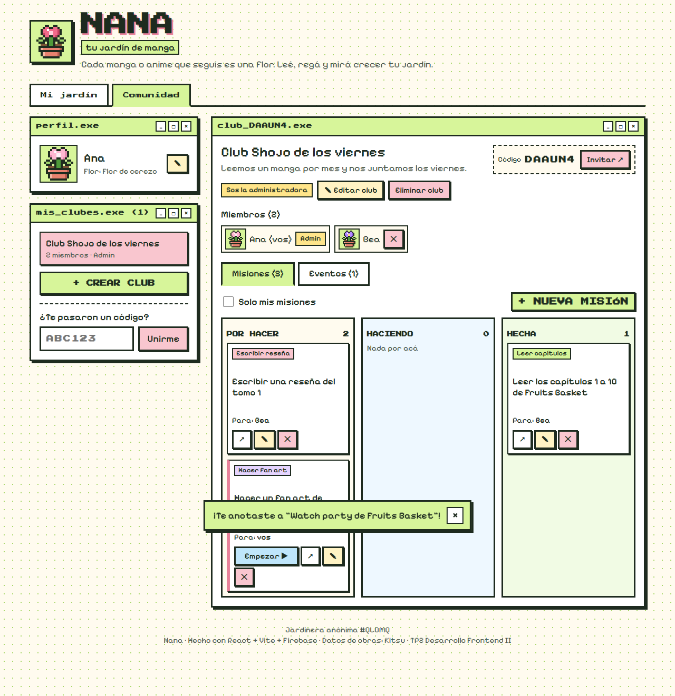 |  |

### Pruebas realizadas (dos usuarias a la vez: Ana y Bea)
| Prueba | Resultado |
|---|---|
| Ana crea su perfil y un club, y queda como administradora | ✅ |
| Una misión vacía muestra errores de validación | ✅ |
| Bea abre el enlace de invitación y el código se completa solo | ✅ |
| Bea se une y ve "Sos miembro" | ✅ |
| Bea **no** ve el botón "Nueva misión" | ✅ |
| Ana ve a Bea en la lista de miembros | ✅ |
| Ana asigna 3 misiones de distintos tipos y edita una | ✅ |
| Bea ve sus 2 misiones marcadas y las mueve: Por hacer → Haciendo → Hecha | ✅ |
| **Firebase rechaza (403)** que Bea cree una misión | ✅ |
| **Firebase rechaza (403)** que Bea cambie el nombre del club | ✅ |
| Bea crea un evento y Ana se anota (van 2) | ✅ |
| Celular sin desplazamiento horizontal | ✅ |
| Bea sale del club | ✅ |
| Ana elimina el club con sus misiones y eventos | ✅ |
| Errores en la consola | ✅ Ninguno |

**Resultado: 19/19 pruebas correctas.**

### Publicación y verificación en Vercel
1. Primero se publicaron las **reglas nuevas** en Firebase y después el código.
2. Se revisó la lista de cambios (37 archivos, sin borrados ni `.env`) y se subió con la etiqueta **`v0.4`**.
3. Vercel la publicó solo, en 4 segundos (*Ready*).
4. **Sobre la URL pública** se repitió la prueba de dos usuarias (**19/19** ✅, incluidos los dos rechazos 403) y además la prueba completa del jardín de la v0.3 (**17/17** ✅), para confirmar que las reglas nuevas no rompieron nada de lo anterior. Esto es una **prueba de regresión**.

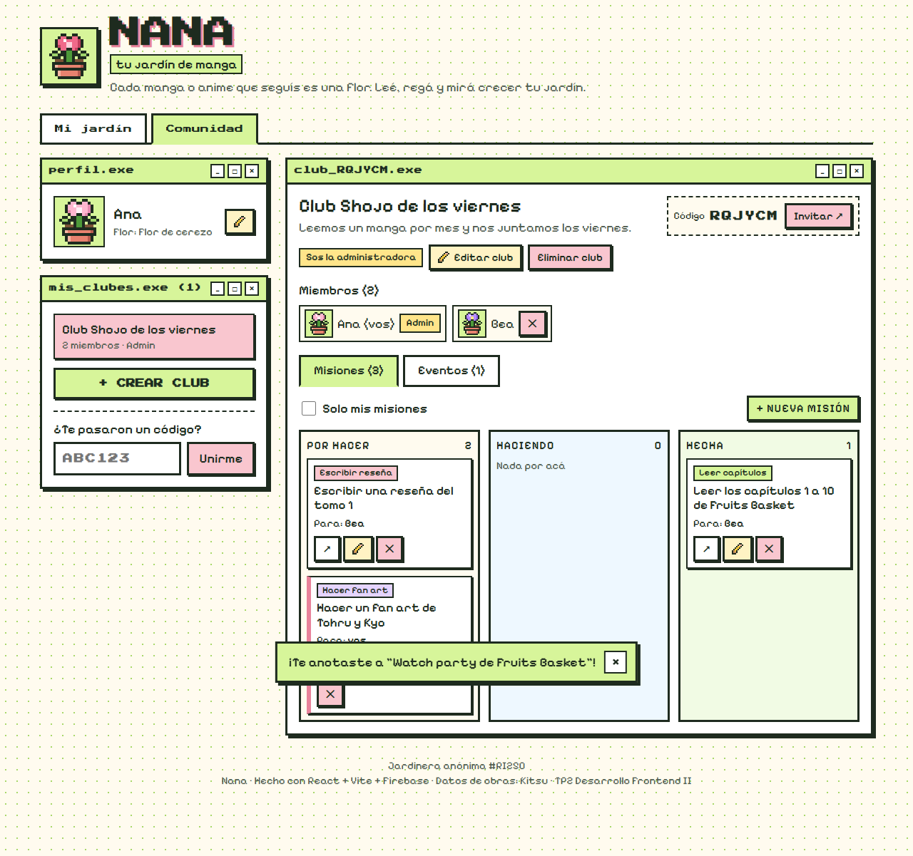
*La v0.4 funcionando en https://jardin-de-manga.vercel.app*


### Ideas para la versión final (v1.0)
- **"Mi ramo":** estadísticas del jardín (flores, capítulos leídos, género favorito).
- **Filtros y buscador** dentro del jardín.
- **Significado de cada flor** (*hanakotoba*).
- **(Opcional)** Guardar la cuenta con Google para recuperar el jardín y los clubes en otro dispositivo, que es la "ampliación opcional" que menciona la consigna.
- Grabar el **video de demostración**.

---

## Versión 0.4.1 — Ajustes de la versión 4: flores únicas, guía, abeja y Nana IA (10/11/2026)

### Por qué una "0.4.1"
Después de probar la v0.4 surgieron mejoras de **diseño y ayuda** que completan esa misma versión. No agregan un módulo nuevo, así que se publicaron como una **versión intermedia** (0.4.1) antes de la final.

### 1. Cada flor con su propia forma
**Antes:** todas las flores eran el mismo dibujo pintado de distinto color.
**Ahora:** hay **9 flores dibujadas con formas distintas**:

| Flor | Forma | Uso | Significado (hanakotoba) |
|---|---|---|---|
| Rosa (*bara*) | Pétalos en espiral | Romance | Amor |
| Girasol (*himawari*) | Pétalos alrededor de un centro grande | Acción | Admiración y energía |
| Tulipán violeta (*chūrippu*) | Copa con tres puntas | Fantasía | Amor eterno y nobleza |
| Margarita (*deijī*) | Rueda de pétalos blancos | Comedia | Inocencia y alegría |
| Flor de cerezo (*sakura*) | Cinco pétalos con muesca | Drama | La belleza de lo que dura poco |
| Hibisco (*haibisukasu*) | Pétalos grandes y estambre largo | Misterio | Belleza delicada |
| Flor estelar | Estrella | Solo avatar | **Inventada por Nana**: guarda deseos |
| Campanilla (*kikyō*) | Campana | Solo avatar | Amor que no cambia |
| Loto (*hasu*) | Pétalos abiertos en capas | Solo avatar | Pureza y volver a empezar |

- Técnicamente, cada flor tiene su "cabeza" (6 filas de píxeles) y comparten el mismo tallo y la misma maceta. Un componente nuevo, `SpriteFlor`, dibuja cualquier flor en cualquier etapa.
- El perfil ahora ofrece **9 avatares** y muestra el significado de la flor elegida. Se actualizó la regla de Firestore del perfil para aceptar las 3 flores nuevas, y **se publicó antes del código**.

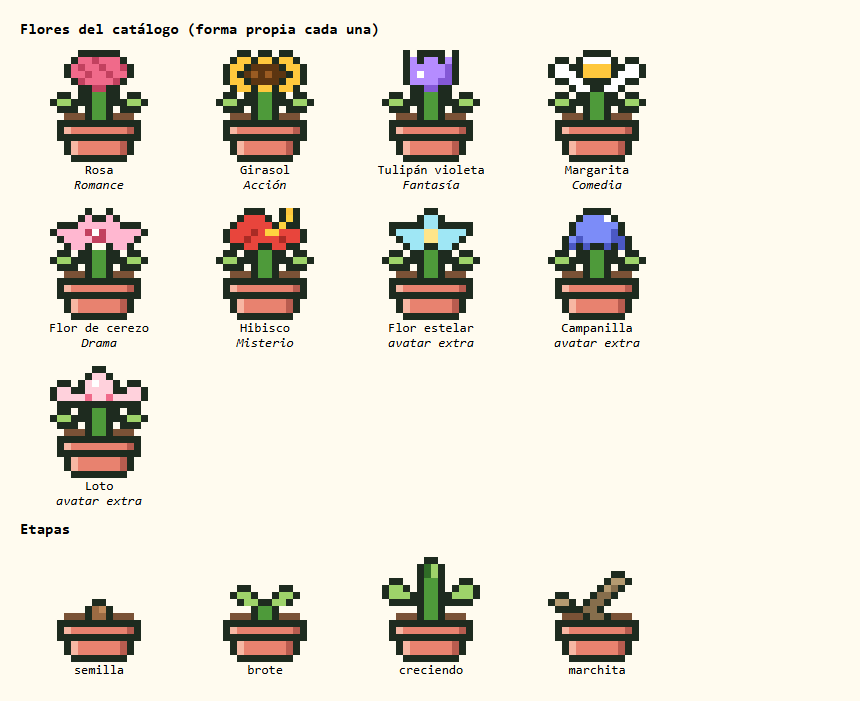
*Hoja con las 9 flores y las etapas de crecimiento.*

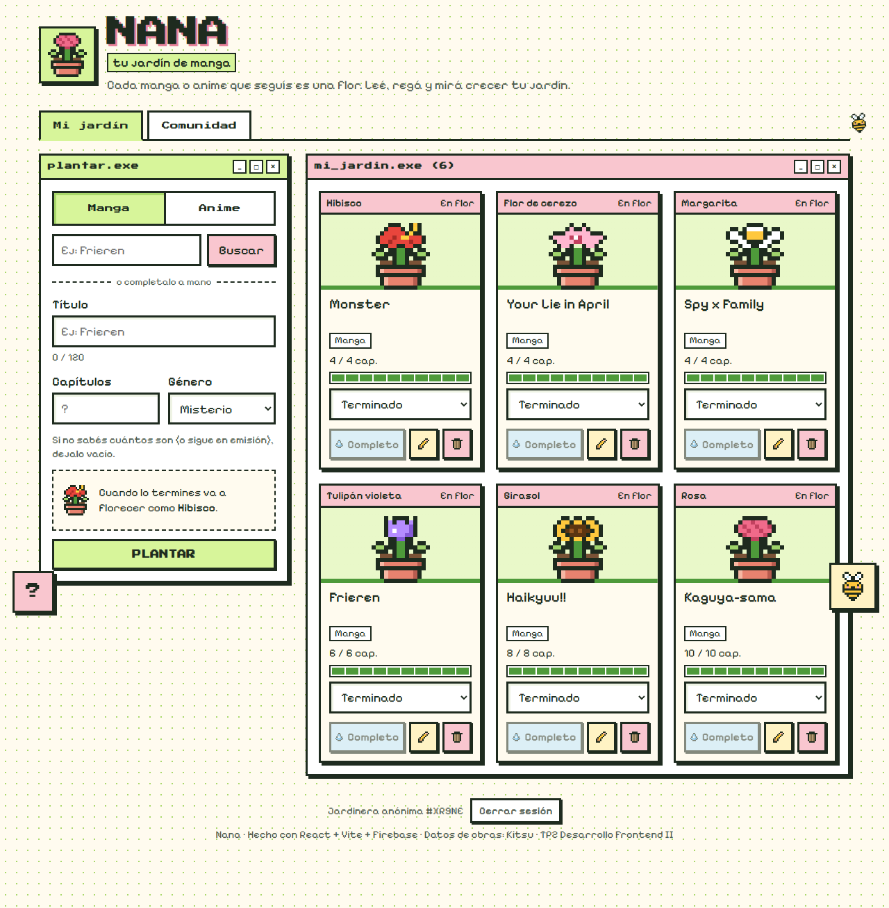
*Un jardín con un manga de cada género: cada uno florece con su forma.*

### 2. Guía flotante "¿Cómo crece tu flor?"
Un botón **"?"** fijo abajo a la izquierda. Al pasar el mouse muestra su etiqueta, y al tocarlo abre la ventana `como_crece.exe`:
- las 4 etapas (semilla → brote → creciendo → en flor) y qué hace falta para llegar a cada una;
- qué pasa si se abandona (se marchita) y cómo revivirla;
- qué flor da cada género.

No ocupa lugar todo el tiempo: se abre solo cuando se necesita.

**Cambio de funcionamiento:** la guía dice que una planta marchita **revive si la regás**. Antes no era así: una planta abandonada seguía marchita aunque se regara. Se corrigió para que la app haga lo que promete: regar una planta abandonada la pasa a "Leyendo".

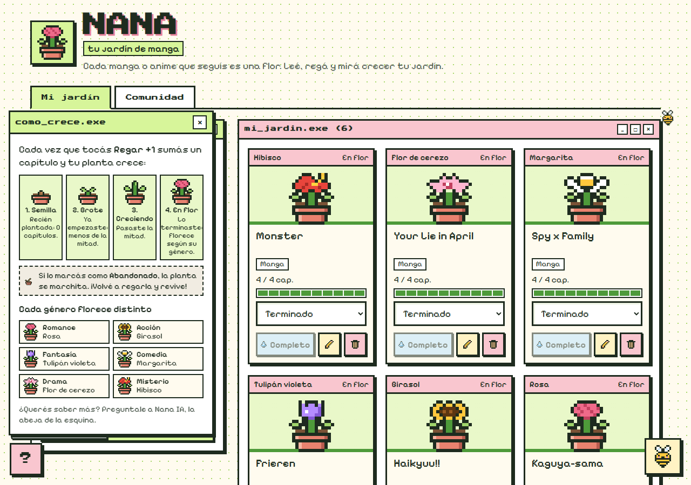

### 3. La abeja que revolotea
Una **abeja pixelada** recorre los bordes de la pantalla, aleteando y parpadeando.
- Es **solo decoración**: no se puede tocar, no tapa botones y los lectores de pantalla la ignoran.
- **Accesibilidad:** si la persona configuró su sistema para "reducir el movimiento", la abeja no aparece.
- El parpadeo usa `useEffect` con `setInterval`, y su **limpieza** (`clearInterval`) detiene el temporizador.

### 4. Nana IA, la asistente virtual
Una abeja con ojitos y cachetes, en la esquina inferior derecha. Al tocarla se abre el chat `nana_ia.exe`, que **explica paso a paso** cómo usar la app. Algunas preguntas que responde:
- "¿Cómo planto un manga?", "¿Cómo crece mi flor?", "¿Qué significa el girasol?";
- "¿Quién asigna las misiones?", "¿Cómo cierro sesión?";
- "¿Cuántas plantas tengo?": esta respuesta usa **tus datos reales** del jardín.

**Decisión de diseño importante: ¿por qué no ChatGPT u otra IA externa?**
Conectar un modelo de IA externo exige una **clave privada**, y la consigna dice que nunca se deben incorporar claves privadas en el código del navegador (con el prefijo `VITE_` quedarían a la vista de cualquiera). Por eso Nana IA funciona con una **base de conocimiento propia** (`src/data/conocimiento.js`):
- 27 temas, cada uno con palabras clave, una respuesta y, si corresponde, los pasos;
- la pregunta se **normaliza** (minúsculas, sin tildes ni signos) y se compara con las palabras clave. Gana el tema con más coincidencias;
- algunas respuestas se arman en el momento: la lista de flores (con `map`), el significado de una flor (con `find`) y el resumen de tu jardín (con `filter` y `reduce`);
- si la pregunta no es sobre Nana, lo dice y ofrece **preguntas sugeridas** que se pueden tocar.

Así cumple lo pedido ("que tenga información de la aplicación y el sitio únicamente"), funciona sin internet extra, no cuesta nada y no expone ninguna clave.

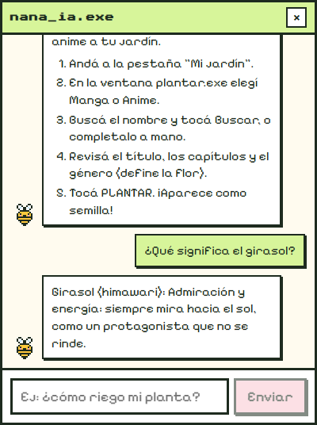
*Nana IA explicando paso a paso cómo plantar y el significado del girasol.*

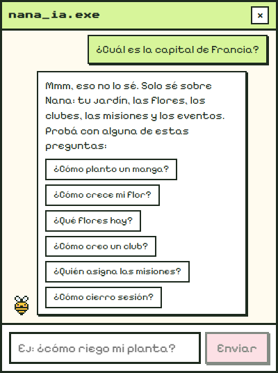
*Si le preguntan algo que no es de la app, lo aclara y sugiere preguntas.*

### 5. Perfil con CRUD completo y "Cerrar sesión"
- El perfil ya se podía **crear, ver y editar**. Faltaba **eliminarlo**: ahora en `perfil.exe` está "Eliminar perfil", que pide confirmación y vuelve a la bienvenida, como al principio.
- **Cerrar sesión**, al pie de la página. Como el acceso es **anónimo**, cerrar sesión significa **empezar de cero**: Firebase crea una identidad nueva con un jardín vacío. Por eso la app lo **advierte antes** en la ventana `cerrar_sesion.exe`, y sugiere editar el perfil si solo se quiere cambiar el apodo.
- Al cambiar de identidad, la Comunidad se reinicia por completo: el componente lleva `key={uid}`, así React lo vuelve a crear de cero.

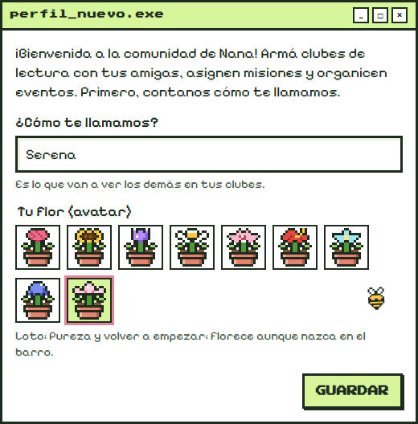
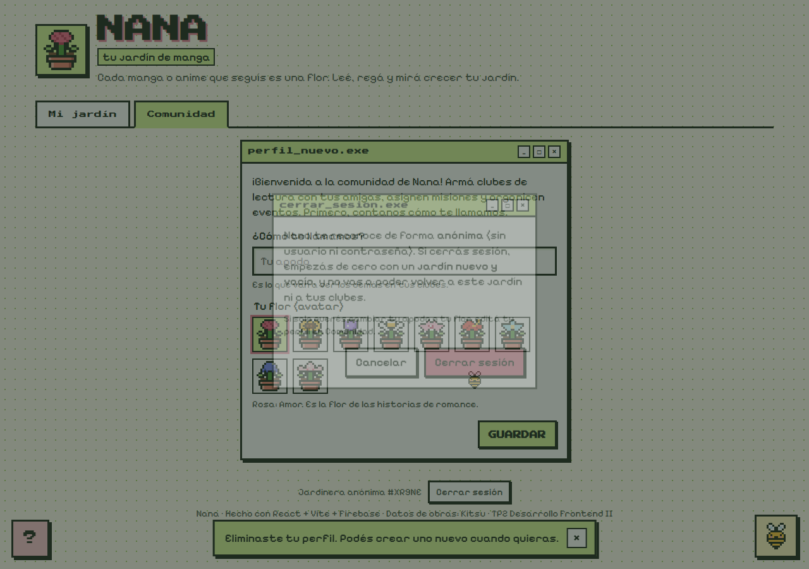

### Dificultades y cómo se resolvieron
| Problema | Cómo se detectó | Solución |
|---|---|---|
| Nana IA no entendía "¿Cómo **planto**…?" ni "¿Cómo **cierro** sesión?" | Prueba automática con preguntas reales | Las palabras clave ahora incluyen raíces ("plant", "rieg", "elimin") y conjugaciones |
| A "¿Cuál es la capital de Francia?" respondía sobre la **API** | La prueba esperaba "no sé" | "c**api**tal" contenía "api". Ahora las claves solo coinciden con el **comienzo de una palabra** |
| A "¿Qué significa la flor de loto?" respondía con la **flor de cerezo** | Revisando el código antes de probar | Se buscaba la primera palabra del nombre ("flor"). Ahora se usan palabras distintivas: loto, hasu, sakura… |
| La guía prometía que la planta revive al regarla, pero no pasaba | Al escribir el texto de la guía | Se cambió la lógica: regar una planta abandonada la pasa a "Leyendo" |

### Pruebas (21 de 21 correctas)
La abeja aparece y es decorativa · las 6 flores distintas en el jardín · la etiqueta del "?" al pasar el mouse · la guía con etapas y géneros · 9 preguntas a Nana IA con su respuesta correcta (incluida una fuera de tema) · las sugerencias se pueden tocar · 9 avatares · el significado del avatar · perfil creado con la flor de loto (la regla nueva lo acepta) · eliminar perfil · cerrar sesión crea una identidad nueva con el jardín vacío · celular sin desplazamiento horizontal con Nana IA abierta · ningún error en la consola.

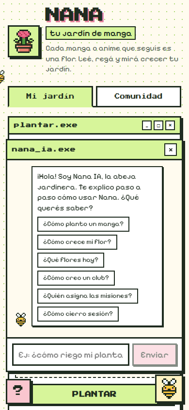

---

## Versión 1.0 — Versión final (quinta versión) (10/11/2026)

### Objetivo
Cerrar el producto: sumar las herramientas para **encontrar y entender** lo que hay en el jardín (filtros, "Mi ramo", herbario), darle **sonido**, **revisar todo contra la consigna** y dejar la documentación lista para la entrega y para el final.

### Qué se agregó

**1. "Mi ramo"**, arriba del jardín
Un resumen con cantidad de plantas, cuántas están en flor, capítulos regados en total y **género favorito**. Debajo, **el ramo**: una flor chiquita por cada manga terminado. Se calcula con `filter`, `reduce` y `map` sobre las plantas que ya están cargadas, así que no hace ninguna consulta extra a la base.

**2. Filtros del jardín**
- buscador por título (sin importar tildes ni mayúsculas);
- chips por estado, con la cantidad de cada uno: *Todas (7) · Pendiente (2) · Terminado (3)…*;
- género, tipo (manga o anime) y **orden** (recientes, A-Z, más avanzadas, más regadas);
- "Mostrando X de Y" y un botón "Limpiar filtros".

Siguiendo la guía de clase, los filtros **no usan `useEffect`**: se calculan durante el renderizado encadenando `filter` y `sort`.

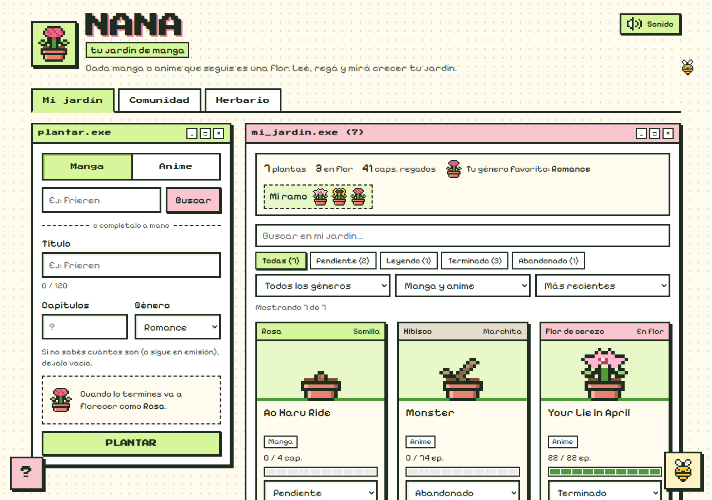
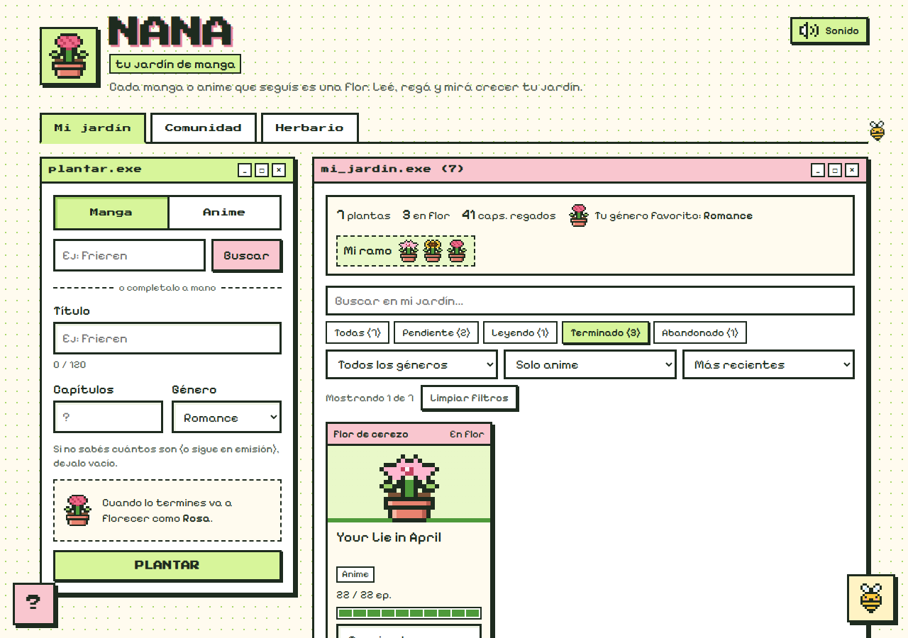
*Filtro "Terminado" + "Solo anime": queda una sola planta.*

**3. Herbario**, la tercera pestaña
El catálogo de las 9 flores, con su dibujo, su nombre en japonés, su significado según el *hanakotoba*, con qué género florece (o si es avatar), **cuántas tenés en tu jardín** y las 4 etapas de crecimiento de esa flor. Además, en cada tarjeta del jardín, al pasar el mouse por el nombre de la flor aparece su significado.


**4. Sonidos retro**
Se generan con la **Web Audio API** del navegador, como un chip de consola: no hay archivos de audio para descargar.

| Acción | Sonido |
|---|---|
| Plantar o asignar una misión | Tres notas que suben |
| Regar | Dos gotitas |
| Florecer o revivir | Arpegio con brillo |
| Compostar o eliminar | Notas que bajan |
| Cumplir una misión | Fanfarria |
| Anotarse a un evento | Dos notas alegres |
| Error | Zumbido grave |
| Abrir Nana IA | Zumbido de abeja |

El botón con el **parlante pixelado** (arriba a la derecha) los apaga o prende. Esa preferencia se recuerda en `localStorage`: es una **preferencia del navegador**, no un dato de la app. Los datos siguen todos en Firebase, como pide la consigna.

**5. Nana IA aprendió los temas nuevos:** filtros, herbario, "Mi ramo" y sonidos.

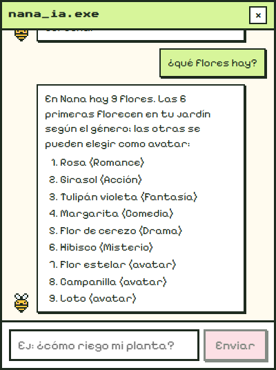

### Auditoría final contra la consigna y la rúbrica
| Requisito | Cómo se cumple | ✔ |
|---|---|---|
| React + Vite: componentes, eventos y estado | 30 componentes. `useState` y `useEffect` en toda la app | ✅ |
| Firestore: consultar, agregar, modificar, eliminar | **5 CRUD completos**: plantas, perfil, clubes, misiones y eventos | ✅ |
| Persistencia al recargar | Todo en Firestore (`localStorage` solo para la preferencia de sonido) | ✅ |
| GitHub con instrucciones | README con pasos, `.env.example`, `firestore.rules`, 6 etiquetas de versión | ✅ |
| Vercel con URL funcional | Despliegue automático en cada `push`, verificado en cada versión | ✅ |
| Validaciones, carga, éxito y error; compu y celular | En todos los formularios. Pruebas a 1280 px y 390 px | ✅ |
| Reglas que no dejen la base abierta | Reglas por dueña y por rol. Probado con 403 | ✅ |
| `.env` fuera de GitHub | Verificado: no está publicado y no hay ninguna llave en el código | ✅ |
| Al menos 3 versiones con cambios identificables | 6: v0.1, v0.2, v0.3, v0.4, v0.4.1 y v1.0 | ✅ |
| Informe (idea, público, funciones, datos en Firebase, IA e instrucciones) | `docs/informe.md`, reescrito **breve** como pide la consigna | ✅ |
| Bitácora con evolución, pruebas, IA, dificultades y capturas | Este documento | ✅ |
| Mini video de demostración | ⏳ Lo graba la autora (guion en `entrega.md`) | ⏳ |
| ¿Hay algo que no cumpla y haya que sacar? | Se revisó: Nana IA no usa claves privadas, los sonidos no usan archivos externos y `localStorage` no guarda datos de la app. **No hubo que quitar nada** | ✅ |

### Dificultades de esta versión
| Problema | Cómo se detectó | Solución |
|---|---|---|
| **El aviso flotante tapaba los botones** que quedaban debajo. Con "Mi ramo" y los filtros, la primera tarjeta bajó justo a la altura del aviso, y tocar "Regar" en esos 3,5 segundos no hacía nada | La **prueba de regresión** de la v0.3 empezó a fallar | El aviso deja pasar los clics (`pointer-events: none`), salvo su botón de cerrar |
| Nana IA confundía "¿Qué es el herbario?" con "¿Qué flores hay?", y "¿Cómo filtro mi jardín?" con el resumen del jardín | Revisando las palabras clave antes de probar | Se separaron las claves que compartían dos temas |
| El 7 de la fuente pixelada parece un 1 ("Todas (7)") | Captura | Se verificó con zoom que el número es correcto: es la forma del 7 en esa fuente |

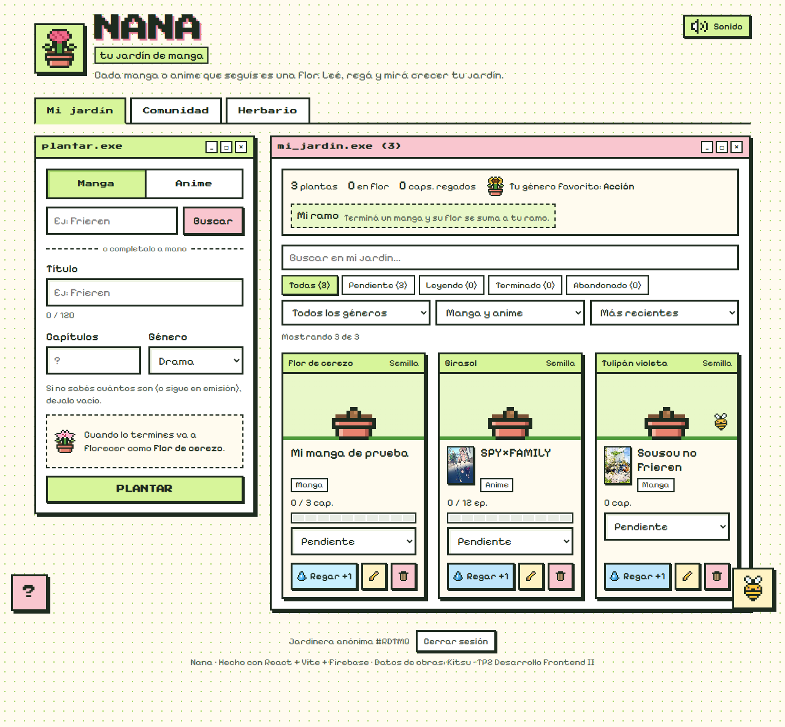
*Antes de la corrección: después de tocar "Regar" en la primera tarjeta no pasaba nada, porque el clic caía sobre el aviso.*

### Pruebas finales
| Prueba automática | Resultado |
|---|---|
| v1.0: Mi ramo, filtros, herbario, sonidos (se cuentan las notas), silencio que se recuerda, Nana IA, celular | **26/26** ✅ |
| Regresión v0.3: jardín, API, edición, estados | **17/17** ✅ |
| Regresión v0.4: comunidad con dos usuarias, roles y seguridad (403) | **19/19** ✅ |
| Regresión v0.4.1: flores, guía, Nana IA, perfil, cerrar sesión | **21/21** ✅ |
| Errores en la consola | Ninguno |

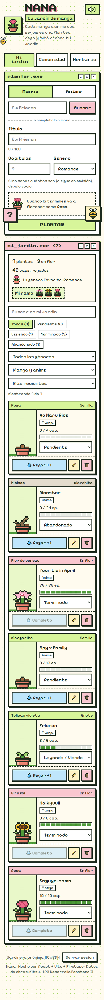

### Publicación y verificación final en Vercel
1. Se revisó la lista de cambios (25 archivos, sin borrados ni `.env`) y se buscaron llaves en el código: no había ninguna.
2. Se subió con la etiqueta **`v1.0`**. Vercel la publicó en 4 segundos (*Ready*).
3. **Sobre la URL pública** se corrieron **todas** las pruebas: v1.0 (26/26), jardín (17/17), comunidad con dos usuarias (19/19) y v0.4.1 (21/21). En total, **83 de 83 correctas** y ningún error en la consola.

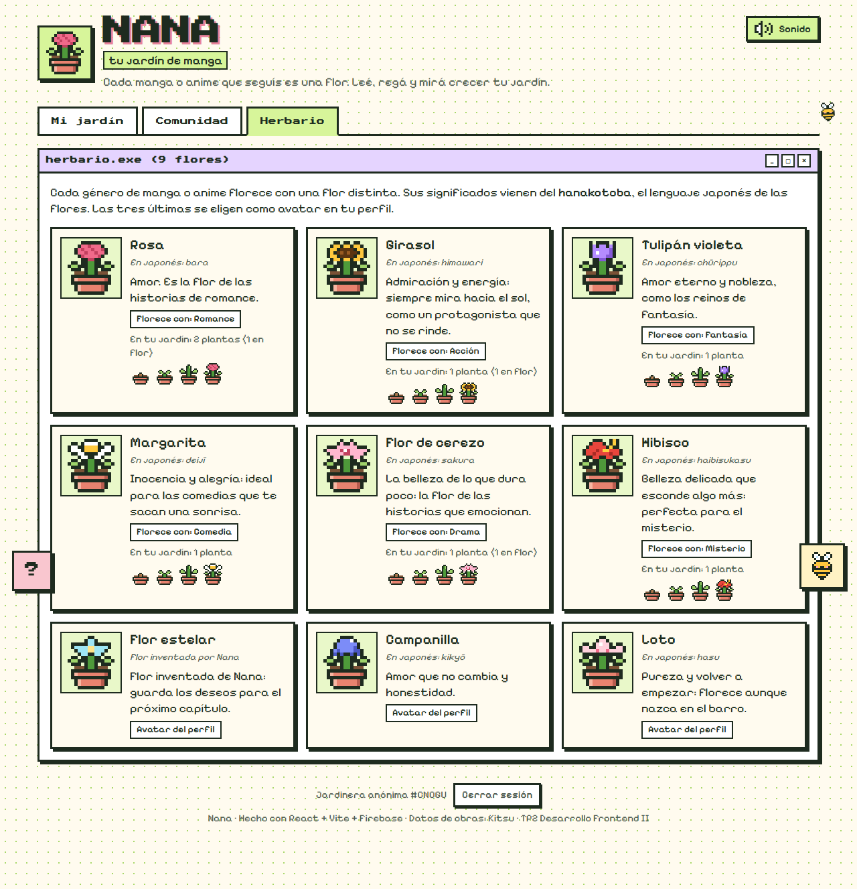


---

## Conclusión del proceso

| Versión | Qué aportó | Tipo de iteración |
|---|---|---|
| v0.1 | MVP: CRUD con Firestore, reglas, GitHub y Vercel | Producto mínimo viable |
| v0.2 | Pixel art, flores dibujadas con código, validaciones, avisos, celular | Diseño y experiencia de uso |
| v0.3 | Nombre "Nana", búsqueda con la API, edición, estados coherentes | Funcionalidad |
| v0.4 | Comunidad: clubes, misiones con rol de administradora, eventos, compartir | Módulo nuevo |
| v0.4.1 | 9 flores con forma propia, guía, abeja, Nana IA, CRUD del perfil | Ajustes de diseño y ayuda |
| v1.0 | Ramo, filtros, herbario, sonidos, auditoría y documentación final | Estabilización |

**Lo que más se aprendió:**
- **Probar es tan importante como programar:** casi todos los errores aparecieron en las capturas o en las pruebas, no al escribir el código.
- **La seguridad no se resuelve escondiendo botones:** se resuelve en las reglas de la base de datos.
- **Una app que depende de servicios externos** (una API) tiene que seguir funcionando si ese servicio falla.
- **La IA acelera mucho el trabajo,** pero hace falta revisar, entender y decidir: varias decisiones (el nombre, el pixel art, la comunidad en clubes, Nana IA sin claves) salieron de esa revisión.
