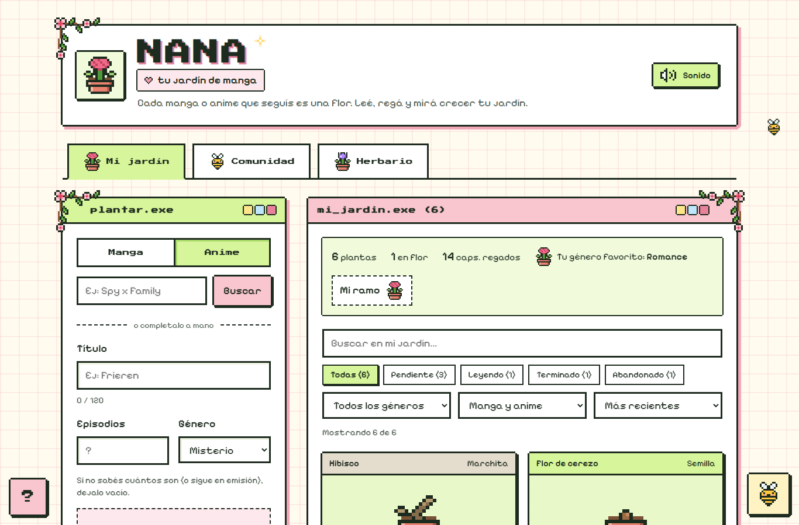
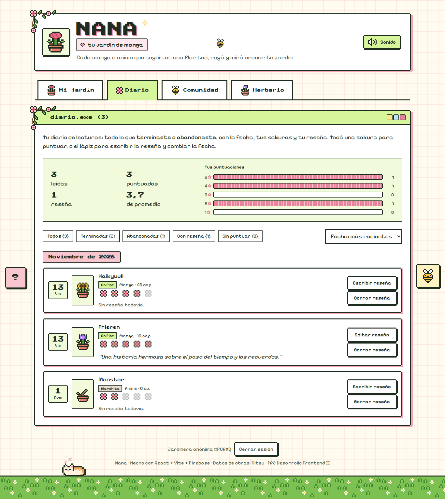
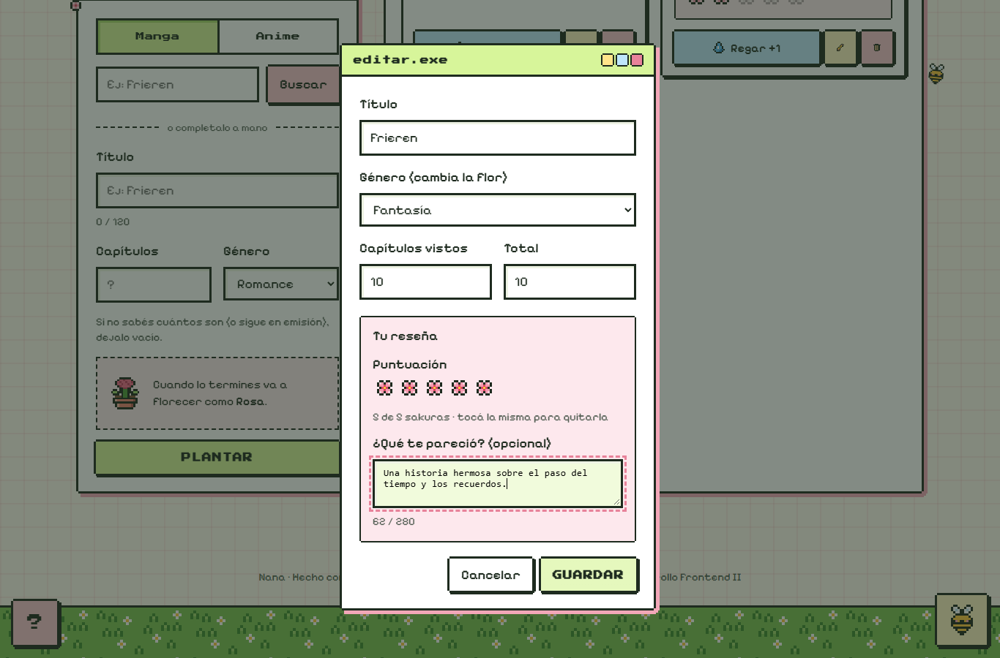
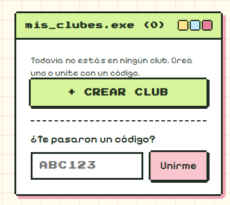
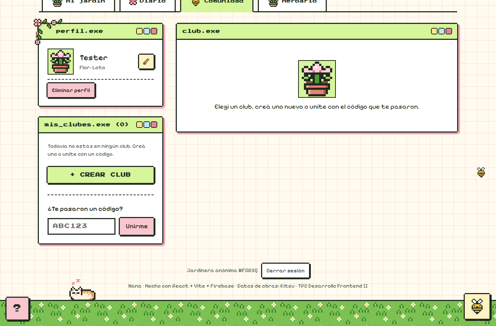
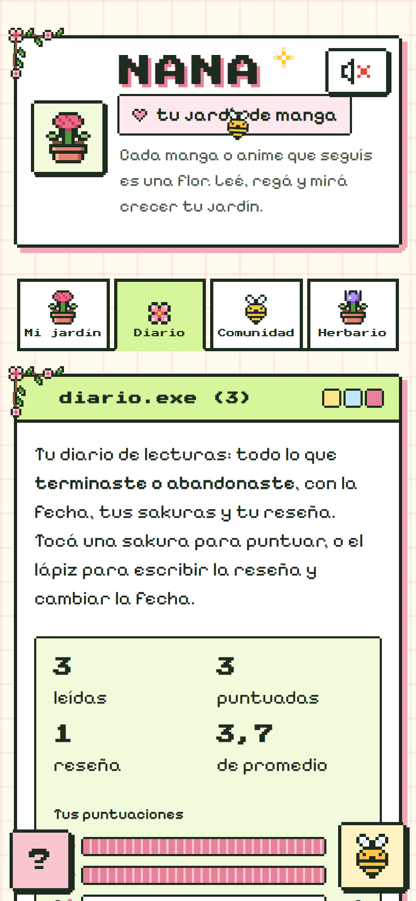

# 📓 Bitácora del proceso — Nana, tu jardín de manga

Resumen de cómo evolucionó la app, versión por versión: qué cambió y por qué, qué decidí en cada etapa, cómo usé la IA como herramienta, qué problemas aparecieron y cómo se resolvieron. Las capturas muestran solo los **cambios reales** entre versiones, y casi todas son de la versión de **compu (desktop)**.

**En total:** una etapa de idea y **8 versiones publicadas** (v0.1, v0.2, v0.3, v0.4, v0.4.1, v1.0, v1.1 y v1.2). La consigna pide al menos tres. Cada versión tiene su etiqueta en GitHub y se probó en la URL de Vercel.

> La versión completa, con todas las pruebas y capturas, quedó como anexo en el repositorio: [bitacora-completa.md](bitacora-completa.md).

## Índice
| Versión | Fecha | Resumen |
|---|---|---|
| [Etapa 0 — La idea](#etapa-0--la-idea-09112026) | 09/11 | Lluvia de ideas y elección |
| [v0.1 — MVP](#versión-01--mvp-que-funcione-0911-y-10112026) | 09-10/11 | CRUD con Firestore, reglas, GitHub y Vercel |
| [v0.2 — Pixel art](#versión-02--identidad-pixel-art-y-experiencia-de-uso-10112026) | 10/11 | Identidad visual, validaciones y avisos |
| [v0.3 — Nana + API](#versión-03--nombre-nana-búsqueda-con-api-y-edición-10112026) | 10/11 | Nombre, búsqueda en Kitsu, edición |
| [v0.4 — Comunidad](#versión-04--comunidad-clubes-misiones-con-roles-y-eventos-10112026) | 10/11 | Clubes, misiones por rol, eventos |
| [v0.4.1 — Ajustes](#versión-041--flores-únicas-guía-abeja-y-nana-ia-10112026) | 10/11 | 9 flores, guía, abeja, Nana IA |
| [v1.0 — Herramientas](#versión-10--mi-ramo-filtros-herbario-y-sonidos-10112026) | 10/11 | Mi ramo, filtros, herbario, sonidos |
| [v1.1 — Pulido kawaii](#versión-11--pulido-de-diseño-kawaii-10112026) | 10/11 | Más espacio, esquinas pixeladas, adornos |
| [v1.2 — Final](#versión-12-final--puntuación-diario-y-música-13112026) | 13/11 | Puntuación, Diario de lecturas, música y revisión final |
| [Cómo se probó y publicó](#cómo-se-probó-y-publicó-cada-versión) | | El mismo ciclo en cada versión |
| [Conclusión](#conclusión) | | Qué se aprendió |

---

## Etapa 0 — La idea (09/11/2026)

Lo primero fue leer la consigna, la rúbrica, la consigna del final y las guías de clase. El final consiste en **defender este mismo proyecto**, así que se buscó una idea que use los temas vistos y se pueda seguir mejorando.

Le pedí a la IA ideas que mezclaran mis gustos (Minecraft, League of Legends, manga/anime y flores) y que permitieran agregar, consultar, modificar y eliminar datos:

| Idea | Por qué sí / por qué no |
|---|---|
| **Jardín de Manga** ✅: cada manga/anime es una flor que crece según lo que leés | Une tres de mis gustos, es muy visual y es una "vuelta de tuerca" al registro de libros que sugiere la consigna |
| Bloque a Bloque (inventario de Minecraft) | Correcta, pero menos original visualmente |
| Champion Lab (diario de LoL) | Más "típica" |
| Quest Log (tareas como misiones) | Muy parecida a una lista de tareas común |
| Herbario Otaku (flores en animes) | Original, pero con pocas acciones posibles |

**Las acciones de la consigna se convierten en jardinería:** agregar = **plantar**, consultar = ver **mi jardín**, modificar = **regar** (+1 capítulo) y cambiar el estado, eliminar = **compostar**.

**Público:** lectoras y lectores de manga y anime que siguen muchas series a la vez y quieren recordar por dónde iban, de una forma más linda que una lista.

**Plan:** trabajar por versiones, como el ciclo **MVP → mejoras → producto** visto en clase.

**Mis decisiones:** elegí la idea entre las cinco. Pensé la equivalencia del CRUD con la jardinería y definí las reglas de trabajo desde el principio: usar solo lo visto en clase (Visual Studio Code, GitHub, Firebase, Vercel y las guías en PDF), documentar cada versión en la bitácora y el informe, y no publicar nunca las llaves.

---

## Versión 0.1 — MVP: que funcione (09/11 y 10/11/2026)

**Objetivo:** cumplir el mínimo de la consigna con un diseño básico a propósito.

**Qué se hizo**
- Proyecto creado con `npm create vite@latest` y Firebase instalado con `npm install firebase`.
- Código ordenado en archivos chicos: `firebase.js` (conexión), `services/plantas.js` (las 4 operaciones), `data/flores.js` y `components/`.
- **Firebase:** app web registrada, acceso **Anónimo** habilitado, Firestore en modo producción (São Paulo) y **reglas publicadas**: cada persona solo ve y cambia su propio jardín.
- Llaves en `.env` (fuera de GitHub), `.env.example` sin valores y README con instrucciones.
- **GitHub y Vercel:** repositorio público y despliegue con Vite, `npm run build` y `dist`, con las 4 variables `VITE_FIREBASE_…` cargadas en Vercel.
- **Verificación (paso 5 de la consigna):** se plantó "Frieren", se vio en *Firestore → Datos*, se modificó, se recargó la página (los datos siguen) y se eliminó. Todo se repitió sobre la URL de Vercel.


*Las primeras reglas publicadas en Firebase: cada visitante solo puede leer y modificar su propio jardín.*


*El registro creado desde la app, guardado en Firestore. Los valores coinciden con la pantalla.*


*La v0.1 publicada en Vercel: funciona, pero el diseño es básico (emojis, bordes grises, sin identidad).*

**Dificultades**
| Problema | Solución |
|---|---|
| El `.gitignore` de Vite **no incluía el `.env`**: las llaves iban a quedar publicadas | Se agregó antes del primer commit. Se verificó en GitHub que `.env` no existe (error 404) |
| Windows bloqueaba `npm run dev` ("ejecución de scripts deshabilitada") | Se usó el comando que indicó el profesor: `Set-ExecutionPolicy RemoteSigned -Scope CurrentUser` |
| Al actualizar el repositorio se **borró `.env.example`** (se había renombrado en vez de copiarse) | Se restauró desde un commit anterior. Desde entonces se revisa `git status` antes de cada commit |
| En Vercel el jardín empezó vacío | No es un error: el acceso es anónimo, y `localhost` y `vercel.app` son dos visitantes distintos |

**Mis decisiones e IA:** le pedí a la IA que todo siguiera lo visto en clase: *"Todo tiene que ser lo que vimos en clase (Visual Studio Code, GitHub y lo de los PDF)"*. Yo:
- corrí los comandos en la terminal de VS Code (`npm install`, `npm run dev`);
- apliqué el permiso de Windows que indicó el profesor;
- copié las llaves de `firebaseConfig` al `.env` y las cargué en Vercel;
- me aseguré de que el `.env` **no se subiera a GitHub**.

Revisé que el código usara lo visto (`useState`, `useEffect`, props, `map`, `try/catch`) y que las llaves se leyeran con `import.meta.env`.

**Lo que quedó anotado para mejorar:** diseño sin identidad, botones que se movían, sin mensajes de éxito, sin confirmación al borrar y sin validaciones claras.

---

## Versión 0.2 — Identidad pixel art y experiencia de uso (10/11/2026)

**Objetivo:** que la app tenga **identidad propia** y resolver los problemas de uso de la v0.1.

**¿Por qué pixel art?** Conecta con un público gamer y otaku, refuerza la idea de "cuidar un jardín como en un juego" y es coherente: bordes oscuros, colores planos y sombras duras en todo.

| Referencia (inspiración, no propia) | Qué se tomó |
|---|---|
|  | Paleta **verde lima + rosa pastel** y flores en maceta pixeladas |
|  | Íconos con contorno negro y barra de carga por bloques |
|  | **Ventanas de computadora retro**: `plantar.exe` y `mi_jardin.exe` |

**Qué cambió**
- **Flores dibujadas con código:** cada dibujo es un *array* de textos y cada letra es un píxel. El componente `PixelSprite` lo recorre con dos `map`. No son imágenes descargadas.
- **Validaciones** debajo de cada campo (título vacío o de más de 120 caracteres, capítulos negativos) y contador "0 / 120".
- **Avisos de éxito y de error** en cada operación, y **barra de carga** por bloques.
- **Confirmación** antes de compostar ("¿Compostar esta planta? Sí / No").
- Botones en un lugar fijo, de al menos 44 px, y barra de progreso en cada tarjeta.

| v0.1 | v0.2 |
|---|---|
|  |  |

**Iteración del dibujo:** en el primer boceto la flor parecía una mancha y la pala no se entendía. Se marcaron los pétalos y la pala se cambió por un tacho de compost.

| Primer boceto | Versión final |
|---|---|
|  |  |


*Los errores del formulario se marcan en rojo, debajo de cada campo.*

**Dificultades**
| Problema | Solución |
|---|---|
| La fuente pixelada unía "fl" en un símbolo y **"flor" se leía "Aor"** | Se desactivaron las ligaduras (`font-variant-ligatures: none`) |
| En el celular, con 2 columnas, los textos se cortaban | Tarjetas horizontales, una por fila |

**Mis decisiones e IA:** el estilo pixel art fue mi elección, y busqué las tres imágenes de referencia: *"Vayamos con la 0.2. Me gustaría que el diseño sea tipo pixel art"*. La IA propuso dibujar las flores como grillas de texto, una aplicación directa de `map` de la guía de arrays. Yo revisé las capturas y pedí rehacer la flor, que parecía una mancha, y el diseño para celular.

---

## Versión 0.3 — Nombre "Nana", búsqueda con API y edición (10/11/2026)

**Objetivo:** sumar funciones nuevas.

**Qué cambió**
- **La app se llama "Nana":** suena a *hana* (花, "flor" en japonés) y une el manga con las flores. "Tu jardín de manga" queda como subtítulo.
- **Búsqueda de obras reales con una API (Kitsu):** con `fetch` se pide la obra, se revisa `respuesta.ok`, se lee el JSON y se transforma con `map`, `filter` y `find`. Al elegir un resultado se completan el título, los capítulos, la portada y la flor sugerida. Tiene estados de carga, error y "sin resultados".
- **Editar una planta** (`editar.exe`): título, género, capítulos vistos y total, con validaciones. Se cierra con Escape.
- **Estados coherentes:** regar por primera vez pasa a "Leyendo"; el último capítulo **florece solo**; marcar "Terminado" completa los capítulos.
- **Reglas más estrictas:** solo se aceptan campos conocidos (`hasOnly`) y los capítulos leídos no pueden superar el total.


*Resultados de la búsqueda "frieren", con portada, año, capítulos y la flor sugerida.*


*La ventana de edición no deja poner más capítulos vistos que el total.*

**Dificultades**
| Problema | Solución |
|---|---|
| **La API planeada (Jikan) estaba caída.** Se probó desde la terminal y desde el navegador, y otras páginas sí respondían | Se comparó con Kitsu y AniList. Se eligió **Kitsu** porque funciona con `fetch` y JSON, como en clase. La búsqueda quedó como **ayuda opcional**: si falla, se completa a mano |
| Si una obra no tenía portada, la regla nueva rechazaba el texto vacío | La portada solo se guarda si existe |
| En el celular el formulario se salía de la pantalla | `minmax(0, 1fr)` en lugar de `1fr` en la grilla |

**Mis decisiones e IA:** el nombre **Nana** fue idea mía (*"Cambiemos el título a Nana."*). Cuando la API planeada no respondió, la IA comparó alternativas. Elegí Kitsu porque funciona con `fetch` y JSON, como en la guía de APIs, y no con GraphQL, que no vimos en la materia.

---

## Versión 0.4 — Comunidad: clubes, misiones con roles y eventos (10/11/2026)

**Objetivo:** darle una **vuelta de tuerca** a la app y sumar acciones con sentido: Nana pasa a ser también una **comunidad de lectura**.

**Qué cambió**
- **Perfil** con apodo y flor-avatar.
- **CRUD de clubes:** quien crea el club es su **administradora**. Cada club tiene un código de 6 letras y un enlace de invitación (`…/?club=CÓDIGO`) que completa el código solo.
- **CRUD de misiones de 6 tipos** (leer, ver episodios, reseña, fan art, teoría, recomendar) en un **tablero Kanban**: Por hacer · Haciendo · Hecha.
- **CRUD de eventos** (lectura conjunta, watch party, debate, intercambio), con lista de asistentes.
- **Compartir** clubes, misiones y eventos.

**El requisito más importante: solo la administradora asigna misiones.** No alcanza con esconder el botón. Por eso la regla está **también en Firestore**: solo el `adminUid` del club puede crear, editar o borrar misiones, y la persona asignada solo puede mover **su** misión. **Prueba:** una usuaria miembro intentó crear una misión llamando directo a Firebase y la respuesta fue **403 (rechazado)**.


*El club visto por la administradora: código, invitación, miembros y misiones de distintos tipos.*


*El mismo club visto por un miembro: no puede asignar misiones, pero mueve las suyas.*

**Dificultades**
| Problema | Solución |
|---|---|
| ¿Cómo unirse a un club si las reglas solo dejan verlo a sus miembros? | El código es el id del documento. Las reglas permiten un solo cambio: agregarse a una misma |
| Un evento de esa noche figuraba como "pasado" 3 horas antes | `toISOString()` usa la hora UTC. Se pasó a la hora local |
| La fuente de títulos no tiene vocales con tilde en mayúscula ("NUEVA MISIóN") | Esos textos usan la otra fuente pixelada |

**Mis decisiones e IA:** los requisitos de esta versión los definí yo, tomando lo trabajado en clase (casos de uso, roles y CRUD): *"Chequeá que se cumpla todo lo que pide la consigna y la rúbrica. Quiero sumar una comunidad […], CRUD de tareas, eventos y grupos, tareas de distintos tipos; el administrador es el único rol que puede asignar tareas […], distintos tipos de iteraciones ágiles."* También decidí que, en lugar de "amigos" sueltos, la comunidad se organice en **clubes**, que permiten roles claros. Con eso se armó la especificación (`especificacion.md`) con requisitos, criterios de aceptación y el diagrama de casos de uso.

---

## Versión 0.4.1 — Flores únicas, guía, abeja y Nana IA (10/11/2026)

**Objetivo:** ajustes de diseño y de ayuda que completan la v0.4.

**Qué cambió**
- **9 flores con forma propia** (rosa, girasol, tulipán, margarita, cerezo, hibisco y tres flores de avatar), cada una con su significado según el *hanakotoba*, el lenguaje japonés de las flores.
- **Guía "¿Cómo crece tu flor?"**: un botón "?" con las etapas y la flor de cada género.
- **Abeja decorativa** que revolotea (no aparece si el sistema pide "reducir el movimiento").
- **Nana IA**, una asistente que responde paso a paso **solo sobre la app**.
- **Perfil con CRUD completo** (eliminar) y **cerrar sesión**, que avisa antes porque empieza un jardín nuevo.


*Las 9 flores y sus etapas de crecimiento, todas dibujadas con código.*

**¿Por qué Nana IA no usa ChatGPT u otra IA externa?** Exigiría una **clave privada**, y la consigna prohíbe poner claves privadas en el código del navegador. Por eso responde con una **base de conocimiento propia** (`conocimiento.js`): no expone claves y no tiene costo.


*Nana IA explicando paso a paso cómo plantar y qué significa el girasol.*

**Mis decisiones e IA:** pedí cada uno de estos agregados: *"Me gustaría que los avatares sean distintos tipos de flores, una leyenda de cómo crece la flor, una abeja revoloteando y una asistente Nana IA […] que tenga información de la aplicación y el sitio únicamente."* Que Nana IA no use claves privadas fue una decisión tomada a partir de la consigna.

**Dificultad:** a "¿Cuál es la capital de Francia?" respondía sobre la **API**, porque "c**api**tal" contiene "api". Ahora las palabras clave solo coinciden con el **comienzo** de una palabra.

---

## Versión 1.0 — Mi ramo, filtros, herbario y sonidos (10/11/2026)

**Objetivo:** herramientas para **encontrar y entender** lo que hay en el jardín.

**Qué cambió**
- **"Mi ramo":** cantidad de plantas, cuántas en flor, capítulos regados y género favorito, calculados con `filter`, `reduce` y `map`.
- **Filtros:** buscador, estado, género, tipo y 4 órdenes, combinables. Se calculan en cada render, sin `useEffect`, como en la guía de clase.
- **Herbario:** el catálogo de las 9 flores con su significado y cuántas tenés.
- **Sonidos retro** generados con la Web Audio API (sin archivos), que se apagan con un botón.


*"Mi ramo" arriba del jardín y los filtros combinables.*


*El herbario con las 9 flores y su significado.*

**Mis decisiones:** para la versión final pedí filtros, el significado de cada flor y sonidos, y una consigna clara: *"Si ves algo que no cumple la consigna, eliminalo."* Se revisó todo y no hubo que sacar nada.

**Dificultad:** el **aviso flotante tapaba los botones** que quedaban debajo, y tocar "Regar" no hacía nada. Lo detectó una **prueba de regresión** de la v0.3. Se corrigió haciendo que el aviso deje pasar los clics (`pointer-events: none`).


*Antes de la corrección: el clic en "Regar" caía sobre el aviso.*

---

## Versión 1.1 — Pulido de diseño kawaii (10/11/2026)

**Objetivo:** los textos estaban "apelmazados". Había que darle aire y hacerla más **kawaii**, **sin cambiar la paleta**.

**Mis decisiones:** noté que los textos estaban apretados y busqué nuevas referencias kawaii: enredaderas de cerezo pixeladas, un planificador rosa y crema, macetas y una baldosa de pasto con margaritas. Pedí darle aire **sin cambiar la paleta** de colores.

**Qué cambió** (todo en un archivo nuevo, `Diseno.css`)
- Una **escala de espacios** (4, 8, 12, 16, 24 y 32 px) usada en toda la app, y más interlineado.
- **Esquinas "redondeadas en píxeles":** se corta el píxel de cada esquina, como en el pixel art.
- **Adornos dibujados con código:** enredaderas de cerezo en las ventanas, un destello, un corazón y una franja de **pasto con margaritas** al pie.
- Fondo de cuaderno cuadriculado, sombras rosadas y pestañas con íconos.

| v1.0 | v1.1 |
|---|---|
|  |  |

**Dificultades**
| Problema | Solución |
|---|---|
| Una regla nueva de la compu "pisó" la del celular y el jardín quedó en dos columnas | Se repitió la regla del celular en `Diseno.css`, que se carga al final |
| Nana IA y la guía dejaron de flotar y aparecían al final de la página | Se les devolvió `position: fixed` |

---

## Versión 1.2 (final) — Puntuación, Diario y música (13/11/2026)

**Objetivo:** a la app "le faltaba algo". Las ideas eran **favoritos / "quiero ver"** o **puntuar como en Letterboxd**, sin saturar el sitio.

**Decisión:** la lista "quiero leer" **ya existía**: es el estado **Pendiente**. Repetirla en otra sección no tenía sentido. Lo que faltaba era **cerrar el ciclo de la planta**: cuando la terminás (o la abandonás), decís qué te pareció.

**Historias de usuario (metodología ágil)**
- *Como lectora, quiero puntuar y reseñar lo que termino, para recordar qué me pareció y encontrar mis favoritas.*
- *Como lectora, quiero un diario con todo lo que leí y puntué, como en Letterboxd.*

**Qué cambió**
- **Puntuación de 1 a 5 sakuras** en la tarjeta, solo si la planta está terminada o abandonada, y una **reseña corta** (hasta 280 caracteres) en la edición. Hay un promedio en "Mi ramo" y un orden "Mejor puntuadas".
- **Pestaña Diario:** todo lo terminado o abandonado, agrupado por mes, con la fecha, la portada, las sakuras y la reseña. Tiene un resumen, un **gráfico de puntuaciones**, filtros y 4 órdenes. **No es una colección nueva:** son las mismas plantas filtradas, así no se duplican datos. Solo se agregó la fecha (`terminadoEn`).
- **Música de fondo original** tipo cajita musical, generada con código (Web Audio). Empieza con el primer toque, porque los navegadores bloquean el sonido automático, y se apaga con el botón Sonido.
- **Gatito dormilón** pixelado sobre el pasto: si lo tocás, maúlla.
- **Espaciado:** más aire en "Mis clubes" y entre los botones del Diario.

**Cómo cumple el CRUD**
| Operación | Puntuación, reseña y Diario |
|---|---|
| Crear | Tocar una sakura o escribir la reseña. Al terminar una obra, entra sola al Diario con la fecha |
| Consultar | La tarjeta, el promedio, el Diario y su gráfico. Todo sigue al recargar |
| Modificar | Tocar otra sakura, editar la reseña o corregir la fecha |
| Eliminar | Tocar la misma sakura, o "Borrar reseña" (con confirmación). El campo se borra de Firestore con **`deleteField()`** |

**Reglas:** la puntuación solo de 1 a 5, la reseña de hasta 280 caracteres y la fecha con formato AAAA-MM-DD. Se probó guardar 9 sakuras, una reseña de 400 caracteres y la fecha "ayer" directo en Firebase: las tres dieron **403 (rechazado)**.


*El Diario: resumen, gráfico de puntuaciones, filtros, el mes como pestaña de cuaderno y cada lectura con su día, sus sakuras y su reseña.*


*La reseña se escribe en la ventana de edición, con contador de caracteres.*

| Antes | Después |
|---|---|
|  |  |

*Espaciado en "Mis clubes": antes, el texto casi tocaba el botón. Después, tiene 24 px de aire.*

**Dificultades**
| Problema | Solución |
|---|---|
| Firebase **rechazaba la puntuación** (las reglas solo aceptan campos conocidos) | Se publicaron las reglas nuevas **antes** de subir el código |
| ¿Cómo "eliminar" una puntuación? Un 0 rompería la regla "de 1 a 5" | `deleteField()` borra el campo del documento |
| Con 4 pestañas, en el celular "Herbario" quedaba **cortada**, aunque la prueba decía "sin scroll horizontal" | Pestañas en 4 columnas iguales. La prueba ahora también mide que ninguna se corte |
| Los botones del Diario se veían pegados (la sombra pixelada ocupaba el espacio) | Se pasó de 8 a 16 px de separación |

**Mis decisiones e IA:** la idea de esta versión y sus condiciones fueron mías: *"puntuarlos como una especie de Letterboxd, pero tampoco me gustaría saturar el sitio web con demasiadas acciones"*. Además: *"cada acción debe poder agregarse, eliminarse y seguir el CRUD […] y además tener la metodología Agile."* Al probar la versión publicada detecté y pedí corregir:
- el texto pegado al botón "Crear club";
- los botones del Diario demasiado juntos;
- la extensión de la bitácora.

También definí la prioridad de diseño: *"una de las cosas que más nos importa del sitio web es cómo se ve en desktop"*. La IA aportó el dato de que "quiero leer" ya existía como estado Pendiente, y escribió el código y las pruebas.

**Integración final:** todo lo de este sprint quedó en **una sola versión final, la v1.2**. La etiqueta de GitHub se movió al último commit.

---

## Cómo se probó y publicó cada versión

Todas las versiones siguieron el mismo ciclo, que es el sprint ágil visto en clase:

**planificar → construir → probar en local → revisar capturas → publicar las reglas (si cambiaban) → subir a GitHub con una etiqueta → Vercel publica solo → repetir las pruebas sobre la URL pública**

**Los comandos de cada publicación**, en la terminal de Visual Studio Code:
```
npm run dev                  # probar en local (http://localhost:5173)
npm run build                # confirmar que compila sin errores
git status                   # revisar qué se sube: sin .env y sin archivos borrados
git add .
git commit -m "v1.2: ..."    # guardar el cambio en el historial
git tag v1.2                 # marcar la versión
git push origin main         # subir el código: Vercel lo detecta y publica solo
git push origin v1.2         # subir la etiqueta
```
Después, en **Vercel → Deployments** se espera el estado *Ready* y se prueba la URL pública. Si cambió la forma de los datos, **antes** de todo esto se publica `firestore.rules` en **Firebase → Firestore → Reglas**.

- **Antes de cada commit** se revisó `git status`: sin archivos borrados, sin `.env` y sin llaves en el código.
- **Las reglas se publican en Firebase antes que el código**, porque desplegar en Vercel no las actualiza.
- **Pruebas automáticas** con un navegador que recorre la app como una persona: planta, riega, edita, recarga y comprueba en Firestore. Cada versión vuelve a correr las pruebas de las anteriores (**pruebas de regresión**).

| Prueba automática | Pasos | Resultado final (sobre Vercel) |
|---|---|---|
| Jardín, API, edición y estados (v0.3) | 17 | ✅ 17/17 |
| Comunidad con dos usuarias a la vez, roles y seguridad 403 (v0.4) | 19 | ✅ 19/19 |
| Flores, guía, Nana IA, perfil y cerrar sesión (v0.4.1) | 21 | ✅ 21/21 |
| Mi ramo, filtros, herbario y sonidos (v1.0) | 26 | ✅ 26/26 |
| Diseño: sin desbordes en compu, tablet y celular (v1.1) | 7 | ✅ 7/7 |
| Puntuación y reseña (v1.2) | 26 | ✅ 26/26 |
| Diario, música, gatito y espaciado (v1.2) | 36 | ✅ 36/36 |
| **Total** | **152** | **✅ 152/152, sin errores en la consola** |

**También en el celular.** La app se diseñó y se revisó sobre todo en la compu, pero la consigna pide que funcione en un celular. Se probó a 390 px en cada versión: sin scroll horizontal, con botones fáciles de tocar y las 4 pestañas completas.


*La versión final publicada, vista en un celular.*

**Revisión final contra la consigna:** los 7 requisitos obligatorios se cumplen y están verificados:
1. React + Vite.
2. CRUD en Firestore.
3. Persistencia al recargar.
4. GitHub con instrucciones.
5. Vercel con URL funcional.
6. Validaciones, carga y mensajes, en compu y celular.
7. Reglas que no dejan la base abierta.

Además, el repositorio tiene README, `.env.example` y `firestore.rules`, y `.env` nunca se subió. El detalle está en el anexo.

---

## Conclusión

| Versión | Qué aportó | Tipo de iteración |
|---|---|---|
| v0.1 | MVP: CRUD con Firestore, reglas, GitHub y Vercel | Producto mínimo viable |
| v0.2 | Pixel art, flores dibujadas con código, validaciones y avisos | Diseño y experiencia de uso |
| v0.3 | Nombre "Nana", búsqueda con la API, edición, estados coherentes | Funcionalidad |
| v0.4 | Comunidad: clubes, misiones con rol de administradora, eventos | Módulo nuevo |
| v0.4.1 | 9 flores, guía, abeja, Nana IA, CRUD del perfil | Ajustes de diseño y ayuda |
| v1.0 | Mi ramo, filtros, herbario, sonidos | Herramientas |
| v1.1 | Más espacio, esquinas pixeladas, enredaderas y pasto | Pulido visual |
| v1.2 | Puntuación, Diario de lecturas, música, gatito y revisión final | Incremento funcional y cierre |

**Lo que más se aprendió:**
- **Probar es tan importante como programar:** casi todos los errores aparecieron en las capturas o en las pruebas, no al escribir el código.
- **La seguridad no se resuelve escondiendo botones:** se resuelve en las reglas de la base de datos.
- **Agregar no siempre es mejor:** antes de sumar una función hay que ver si ya existe de otra forma ("quiero leer" ya era el estado Pendiente).
- **Una app que depende de un servicio externo** tiene que seguir funcionando si ese servicio falla.
- **La IA acelera mucho el trabajo,** pero hace falta revisar, entender y decidir. Varias decisiones (el nombre, el pixel art, los clubes, Nana IA sin claves, el Diario sin duplicar datos) salieron de esa revisión.
