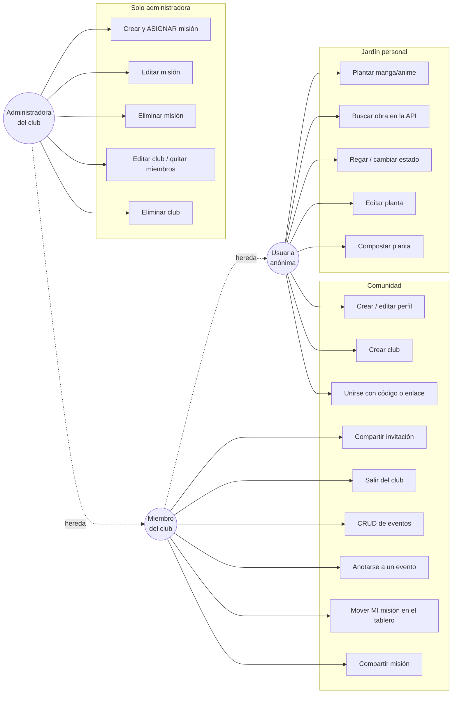
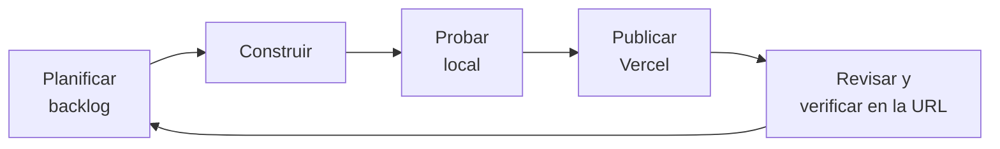

# Especificación — Nana, tu jardín de manga

Este documento describe **qué tiene que hacer la aplicación** (requisitos), **quién la usa** (actores y casos de uso) y **cómo se organizó el trabajo** (iteraciones ágiles). Sirve como referencia para construir y para verificar: cada requisito tiene un criterio de aceptación que se comprobó con pruebas.

> Como vimos en clase ("de los prompts a las especificaciones"), una instrucción general a la IA da resultados difíciles de controlar. Con una especificación se puede pedir, construir y **verificar** con precisión.

---

## 1. Objetivo del producto
Ayudar a lectoras y lectores de manga y anime a **llevar registro de lo que siguen** de una forma visual y motivadora (cada obra es una flor que crece) y a **leer en comunidad**: armar clubes de lectura, repartirse misiones y organizar eventos.

## 2. Usuarios (actores)

| Actor | Quién es | Qué puede hacer |
|---|---|---|
| **Usuaria anónima** | Cualquier persona que abre la app. Firebase le da una identidad sin pedirle registro | Cuidar su jardín privado y crear su perfil |
| **Miembro de un club** | Usuaria que se unió a un club con el código | Ver el club, mover **sus** misiones, crear eventos y anotarse |
| **Administradora del club** | Quien creó el club | Todo lo anterior, más **asignar, editar y borrar misiones**, editar el club, quitar miembros y borrar el club |

## 3. Diagrama de casos de uso



## 4. Requisitos funcionales

| Código | Requisito | Criterio de aceptación | Versión |
|---|---|---|---|
| RF01 | Agregar, consultar, modificar y eliminar plantas (mangas/animes) | Los cambios aparecen en Firestore y siguen ahí al recargar | v0.1 |
| RF02 | Mostrar el avance como una flor que crece | Semilla → brote → creciendo → flor; marchita si se abandona | v0.2 |
| RF03 | Buscar obras reales en una API | Al elegir un resultado se completan título, capítulos, género y portada | v0.3 |
| RF04 | Estados coherentes | Regar pasa a "Leyendo"; el último capítulo florece; "Terminado" completa los capítulos | v0.3 |
| RF05 | Perfil público (apodo y flor) | Se crea antes de entrar a la comunidad y se puede editar | v0.4 |
| RF06 | **CRUD de grupos** (clubes de lectura) | Crear, ver, editar y eliminar un club. Al eliminarlo se borran sus misiones y eventos | v0.4 |
| RF07 | Unirse a un club con un código o un enlace | El enlace `?club=CÓDIGO` completa el código. Un código inválido muestra un error | v0.4 |
| RF08 | **CRUD de tareas** (misiones) de **distintos tipos** | 6 tipos: leer, ver episodios, reseña, fan art, teoría, recomendar | v0.4 |
| RF09 | **Solo la administradora asigna tareas** | Los miembros no ven el botón y **Firebase rechaza (403)** el intento aunque se saltee la interfaz | v0.4 |
| RF10 | La persona asignada mueve su misión en un **tablero Kanban** | Por hacer → Haciendo → Hecha (y puede volver) | v0.4 |
| RF11 | **Compartir** club, misión o evento | Menú de compartir del celular o copia al portapapeles en la compu | v0.4 |
| RF12 | **CRUD de eventos** | Cualquier miembro crea. Editan o eliminan quien lo creó o la administradora | v0.4 |
| RF13 | Anotarse o borrarse de un evento | La lista "Van (n)" se actualiza | v0.4 |
| RF14 | Salir de un club o quitar miembros | Un miembro sale. La administradora quita a otros | v0.4 |

## 5. Requisitos no funcionales

| Código | Requisito | Cómo se cumple |
|---|---|---|
| RNF01 | Persistencia real | Todo se guarda en Cloud Firestore (no en arrays ni `localStorage`) |
| RNF02 | Seguridad | Reglas de Firestore por rol: el jardín es privado, los clubes los ven solo sus miembros, las misiones las asigna solo la administradora, se valida la forma de cada dato y se aceptan solo campos conocidos |
| RNF03 | Llaves protegidas | Están en `.env` (fuera de GitHub). En Vercel, como variables de entorno |
| RNF04 | Celular y compu | Diseño adaptable, sin desplazamiento horizontal a 390 px, botones de al menos 44 px |
| RNF05 | Retroalimentación | Validaciones por campo, indicadores de carga y avisos de éxito o error |
| RNF06 | Accesibilidad básica | Etiquetas en todos los campos, roles ARIA en pestañas, avisos y diálogos, foco visible, cierre con Escape |
| RNF07 | Tolerancia a fallas | Si la API externa falla, se puede completar todo a mano |
| RNF08 | Costo cero | Plan gratuito de Firebase (Spark), Vercel (Hobby) y una API sin clave |

## 6. Modelo de datos (Firestore)

```
users/{uid}                         perfil público: apodo, flor
users/{uid}/plantas/{id}            jardín privado: titulo, tipo, genero, estado, capítulos, portada...
clubes/{CÓDIGO}                     nombre, descripcion, adminUid, miembros[]
clubes/{CÓDIGO}/misiones/{id}       titulo, tipo, descripcion, asignadaA, estado, fechaLimite
clubes/{CÓDIGO}/eventos/{id}        titulo, tipo, fecha, lugar, descripcion, asistentes[]
```

---

## 7. Organización ágil del trabajo

El proyecto se desarrolló con **iteraciones cortas**, como vimos en clase con el ciclo *MVP → mejoras → producto*. Cada versión fue un **sprint** con este ciclo:

**planificar → construir → probar → publicar en Vercel → revisar → anotar mejoras para el próximo sprint**



### Sprints (versiones)

| Sprint | Objetivo | Entregado | Tipo de iteración |
|---|---|---|---|
| 0 | Definir la idea | Lluvia de ideas, elección, plan | Descubrimiento |
| v0.1 | **MVP**: que funcione | CRUD con Firestore, reglas, GitHub y Vercel | Producto mínimo viable |
| v0.2 | Mejorar la experiencia | Identidad pixel art, validaciones, avisos, celular | Iteración de diseño y UX |
| v0.3 | Nuevas funciones | API Kitsu, edición, estados coherentes, nombre "Nana" | Iteración funcional |
| v0.4 | Comunidad | Perfiles, CRUD de clubes, misiones con roles, eventos, compartir | Incremento grande (nuevo módulo) |
| v1.0 | Versión final | Pulido, estadísticas, pruebas finales y entrega | Estabilización |

### Backlog (tablero Kanban del proyecto)

| Por hacer | Haciendo | Hecho |
|---|---|---|
| Estadísticas "Mi ramo" | v0.4 · Comunidad | CRUD de plantas (v0.1) |
| Filtros y buscador del jardín | | Reglas de seguridad (v0.1) |
| Significado de cada flor (hanakotoba) | | Publicación en Vercel (v0.1) |
| Video de demostración | | Pixel art y celular (v0.2) |
| (Opcional) Guardar la cuenta con Google para usarla en otro dispositivo | | API Kitsu y edición (v0.3) |

> La app aplica la misma idea dentro de cada club: las **misiones** se organizan en un **tablero Kanban** (Por hacer / Haciendo / Hecha).

## 8. Estrategia de pruebas

| Tipo de prueba (vista en clase) | Cómo se hizo en Nana |
|---|---|
| **Funcional**: ¿cumple lo pedido? | Pruebas automáticas que recorren cada requisito: 17 pasos en la v0.3 y 19 en la v0.4 |
| **Integración**: ¿se comunican bien React, Firebase y la API? | Se verificaron los datos en la consola de Firestore. Las pruebas recargan la página y comprueban que todo siga |
| **Seguridad**: ¿las reglas protegen? | Una usuaria que no es administradora intenta crear una misión y editar el club **llamando directamente a Firebase**: responde **403 (rechazado)** |
| **Usabilidad**: ¿se entiende? | Revisión de capturas en compu y celular. A partir de eso se corrigieron textos cortados, botones fuera de lugar y la tipografía |
| **Accesibilidad** | Etiquetas, roles ARIA, foco visible, tamaño mínimo de botones y contraste por el contorno oscuro |
