# Informe — Nana, tu jardín de manga

**Trabajo Práctico 2 · Desarrollo Frontend II · UADE**
Prof. Joaquín Cerviño · Viernes, turno noche · 2.º cuatrimestre 2026 · Versión final: **v1.2**

| Entrega | Enlace |
|---|---|
| App publicada (Vercel) | https://jardin-de-manga.vercel.app |
| Repositorio (GitHub) | https://github.com/serenaretrive02/jardin-de-manga |
| Bitácora del proceso (8 versiones publicadas, con capturas) | [bitacora.md](bitacora.md) |
| Especificación (requisitos, casos de uso, sprints) | [especificacion.md](especificacion.md) |
| Guía para el oral (dónde está cada tema en el código) | [guia-oral.md](guia-oral.md) |
| Video de demostración | _pendiente: agregar el enlace_ |

---

## 1. La idea y su público
**Nana** es una app para llevar el registro de los mangas y animes que seguís. **Cada título es una flor**: la especie depende del género (romance → rosa, acción → girasol, fantasía → tulipán…) y la planta **crece a medida que avanzás capítulos** (semilla → brote → creciendo → en flor). Si la abandonás, se marchita. **Cuando la historia termina para vos, la puntuás de 1 a 5 sakuras** (flores de cerezo), podés dejar una reseña corta y queda anotada en tu **Diario de lecturas**, como en Letterboxd. Además, Nana es una **comunidad**: permite armar clubes de lectura con amigas, repartirse misiones y organizar eventos.

**Necesidad que resuelve:** quienes leen manga o miran anime siguen muchas series a la vez y se olvidan por dónde iban. Nana lo guarda y lo muestra de forma visual y motivadora, y suma la experiencia de leer en grupo.

**Público:** lectoras y lectores de manga y espectadores de anime, sobre todo jóvenes, que no quieren crear una cuenta ni completar formularios largos (el ingreso es anónimo).

**Por qué se ve así:** estética **pixel art** de videojuego retro (ventanas tipo "programa", paleta lima y rosa, sombras duras), porque conecta con un público gamer y otaku y refuerza la idea de "cuidar un jardín" como en un juego. Las 9 flores, la abeja, las enredaderas y el pasto están **dibujados con código**: son arrays de texto que React convierte en píxeles. En la última iteración (v1.1) se sumó un toque **kawaii** inspirado en planificadores tiernos: más espacio para que los textos respiren, esquinas "redondeadas en píxeles", sombras rosadas y enredaderas de cerezo, siempre con la misma paleta. En la versión final se sumaron un **gatito dormilón** pixelado y una **canción de fondo original** tipo cajita musical, que se apaga con el botón Sonido. El diseño se refinó en ocho versiones a partir de referencias visuales y de las capturas de cada prueba (ver la bitácora).

## 2. Funciones implementadas (todas con CRUD)

| Módulo | Crear | Consultar | Modificar | Eliminar |
|---|---|---|---|---|
| **Jardín** (plantas) | Plantar, a mano o buscando en la API | Ver el jardín con filtros, buscador, orden y "Mi ramo" | Regar +1, cambiar el estado, editar | Compostar (con confirmación) |
| **Puntuación y reseña** (v1.2) | Tocar una sakura o escribir la reseña (solo si la planta terminó o se abandonó) | En la tarjeta, el promedio de "Mi ramo" y el orden "Mejor puntuadas" | Tocar otra sakura o editar el texto | Tocar la misma sakura o vaciar la reseña: el campo se borra con `deleteField()` |
| **Diario de lecturas** (v1.2) | Al terminar o abandonar una obra se anota sola con la fecha (`terminadoEn`) | Pestaña Diario: lecturas por mes, resumen, gráfico de puntuaciones, filtros y 4 órdenes | Puntuar, reseñar y corregir la fecha | "Borrar reseña" (con confirmación); si vuelve a "Leyendo", sale del diario y la fecha se borra |
| **Perfil** | Apodo y flor-avatar (9 flores) | Ver el perfil y el de los miembros | Editar | Eliminar perfil |
| **Clubes** (grupos) | Crear club (con código e invitación) | Mis clubes, miembros | Editar club; unirse, salir o quitar miembros | Eliminar club (borra sus misiones y eventos) |
| **Misiones** (tareas de 6 tipos) | Crear y **asignar: solo la administradora** | Tablero Kanban, "solo mis misiones" | Mover de columna (la persona asignada); editar (la administradora) | Eliminar (la administradora) |
| **Eventos** | Cualquier miembro | Próximos y pasados | Editar (quien lo creó o la administradora); anotarse o borrarse | Eliminar (quien lo creó o la administradora) |

**Además:**
- **Compartir** clubes, misiones y eventos (menú del celular o portapapeles), con un enlace de invitación que completa el código solo.
- **Favoritas sin sección aparte:** el orden "Mejor puntuadas" deja arriba las que más te gustaron. La lista "quiero leer" ya existe: es el estado **Pendiente**.
- **Herbario** con las 9 flores, su significado (*hanakotoba*) y cuántas tenés.
- **Guía flotante** de cómo crece la flor.
- **Nana IA**, una asistente con forma de abeja que responde paso a paso sobre la app.
- **Música de fondo original** (cajita musical generada con Web Audio, sin archivos) y **sonidos** retro. Todo se apaga con un solo botón.
- **Gatito dormilón** sobre el pasto: si lo tocás, maúlla y aparece un corazón.
- **Cerrar sesión**, que empieza un jardín nuevo y avisa antes.

**Experiencia de uso (consigna, punto 6):**
- validaciones con mensajes debajo de cada campo (título, capítulos, reseña, fecha del diario);
- barras de carga pixeladas;
- avisos de éxito y de error en cada operación;
- diseño probado en compu y en celular (390 px), con botones de al menos 44 px.

## 3. Información guardada en Firebase
- **Authentication (anónimo):** identifica a cada visitante sin pedirle registro.
- **Cloud Firestore:**

| Ruta | Qué guarda | Quién lo ve |
|---|---|---|
| `users/{uid}/plantas/{id}` | título, tipo, género, estado, capítulos leídos y totales, portada y número de Kitsu (opcionales), puntuación de 1 a 5, reseña de hasta 280 caracteres y fecha del diario `terminadoEn` (opcionales, v1.2), fecha de creación | Solo su dueña |
| `users/{uid}` | apodo y flor-avatar | Cualquier visitante identificado (para mostrar nombres en los clubes) |
| `clubes/{CÓDIGO}` | nombre, descripción, administradora, miembros | Solo sus miembros |
| `clubes/{CÓDIGO}/misiones/{id}` | título, tipo, a quién está asignada, estado, fecha límite | Miembros del club |
| `clubes/{CÓDIGO}/eventos/{id}` | título, tipo, fecha, lugar, asistentes | Miembros del club |

**Seguridad:**
- Las **reglas de Firestore** (`firestore.rules`) controlan quién puede hacer qué y que cada dato tenga la forma correcta, y solo aceptan campos conocidos.
- **Solo la administradora puede crear o asignar misiones.** Se probó llamando directo a Firebase como miembro: la respuesta fue **403 (rechazado)**.
- La **puntuación** solo se acepta si es un entero de 1 a 5, y la **reseña** si tiene de 1 a 280 caracteres. La fecha del diario solo se acepta con formato AAAA-MM-DD. Se probó guardar 9 sakuras, una reseña de 400 caracteres y la fecha "ayer" llamando directo a Firebase: **403 (rechazado)**.
- Las **llaves de conexión** están en `.env`, que **no está en GitHub**. En Vercel se cargaron como variables de entorno.

**Dónde se configura Firebase:** en `src/firebase.js`, que lee las variables `VITE_FIREBASE_…` del `.env` con `import.meta.env`. Las operaciones están en `src/services/` (`plantas.js`, `perfiles.js`, `clubes.js`, `misiones.js`, `eventos.js`).

## 4. Herramientas utilizadas
Visual Studio Code · Node.js + npm · React + Vite · Firebase (Authentication y Cloud Firestore) · Git + GitHub · Vercel · API pública de **Kitsu** (búsqueda de obras, sin clave) · **Claude Code** (asistente de IA de Anthropic) · Google Chrome con navegador automático (para pruebas y capturas).

## 5. Mi trabajo y el uso de la inteligencia artificial

### Cómo trabajé
La IA (**Claude Code**, que trabaja sobre la carpeta del proyecto en Visual Studio Code) fue una **herramienta**: escribió gran parte del código, las pruebas automáticas y los borradores de la documentación. **La dirección del proyecto fue mía:** qué hacer, en qué orden, con qué reglas y cuándo algo estaba bien o había que corregirlo.

**Decisiones que tomé yo**
| Decisión | Por qué |
|---|---|
| Elegir **Jardín de Manga** entre cinco ideas y convertir el CRUD en jardinería (plantar, regar, compostar) | Une mis gustos y le da una "vuelta de tuerca" al registro de libros que propone la consigna |
| Trabajar **por versiones**, como el ciclo *MVP → mejoras → producto* visto en clase | La consigna pide al menos 3 versiones y cada una tenía que poder probarse y publicarse |
| El estilo **pixel art** y después el toque **kawaii**, a partir de imágenes de referencia que busqué yo | Conecta con el público gamer y otaku, y la paleta lima y rosa se mantuvo en todas las versiones |
| El nombre **Nana** (de *hana*, "flor") | Une el manga con las flores |
| Que la comunidad tenga **CRUD de clubes, tareas y eventos**, y que **solo la administradora asigne tareas** | Son los requisitos que se trabajaron en clase con casos de uso y roles |
| Que **cada acción respete el CRUD** (crear, consultar, modificar y eliminar) y siga la **metodología ágil** | Es lo que evalúa la materia |
| Que Nana IA **no use claves privadas** | La consigna prohíbe claves privadas en el navegador |
| **No duplicar** una lista de favoritos: "quiero leer" ya era el estado Pendiente; sumar la puntuación y el Diario | No saturar el sitio y mantener la coherencia |
| Priorizar la **vista de compu (desktop)** sin descuidar el celular | Es como se va a mostrar y evaluar el trabajo |

**Lo que hice yo directamente**
- Ejecuté los comandos del proyecto en la terminal de VS Code (`npm install`, `npm run dev`) y apliqué el permiso de Windows que indicó el profesor (`Set-ExecutionPolicy RemoteSigned -Scope CurrentUser`).
- Cargué las **llaves de Firebase** en el `.env` y en **Vercel → Environment Variables**, y cuidé que el `.env` **nunca** se subiera a GitHub.
- Publiqué reglas de Firestore en la consola de Firebase y moví la etiqueta final `v1.2` en GitHub con `git tag` y `git push`.
- **Revisé cada versión en el navegador** y detecté problemas que después se corrigieron: el texto pegado al botón "Crear club", los botones del Diario demasiado juntos, la pestaña cortada en el celular, los cambios que no se veían por la caché del navegador.
- Busqué y elegí las **referencias visuales** (pixel art, ventanas retro, enredaderas de cerezo, planificadores kawaii, gatitos pixelados).
- La grabación del mini video de demostración, siguiendo el guion que armé (`docs/guion-video.md`).

**Cómo verifiqué lo que hizo la IA**
- Cada versión se probó con **pruebas automáticas**: 152 en total en la versión final, incluida una con dos usuarias a la vez.
- Revisé las **capturas** en compu y en celular.
- Comprobé los datos en la **consola de Firestore**.
- Repetí las pruebas **sobre la URL de Vercel**.

Así se encontraron y corrigieron más de 25 problemas (ver la bitácora). Los pasos que publicaban algo o tocaban las llaves se hicieron con mi autorización o los hice yo.

### Instrucciones representativas que di
Estas instrucciones muestran que el trabajo siguió lo visto en clase:
1. **Herramientas de clase:** *"Todo lo que hagamos tiene que ser lo que vimos en clase (Visual Studio Code, GitHub y lo de los PDF)."*
2. **Seguridad de las llaves:** *"[El `.env` con las llaves] evitar que se publique en GitHub, si no baja puntos."* (paso 6 de la consigna).
3. **Idea original:** *"Antes de crear cualquier aplicación, pensá ideas sumamente creativas y originales según las cosas que me gustan (Minecraft, LoL, manga, anime, flores), que permitan hacer cada acción que pide la consigna, pero que no sea una típica."*
4. **Diseño propio:** *"Vayamos con la 0.2. Me gustaría que el diseño sea tipo pixel art"*, con tres imágenes de referencia que elegí.
5. **CRUD, roles y ágil:** *"Chequeá que se cumpla todo lo que pide la consigna y la rúbrica […]. Quiero sumar una comunidad, grupos de lectura, CRUD de tareas, eventos y grupos, tareas de distintos tipos […]. El administrador es el único rol que puede asignar tareas. […] Distintos tipos de iteraciones ágiles."*
6. **Ayuda dentro de la app:** *"Una asistente Nana IA […] que tenga información de la aplicación y el sitio únicamente. […] Si ves algo que no cumple la consigna, eliminalo."*
7. **CRUD en cada acción:** *"Recuerda que cada acción debe poder agregarse, eliminarse y seguir el CRUD, que es create, delete, update y todo lo que significa CRUD, por lo que cada acción debe respetar esto y además tener la metodología Agile."*
8. **Sin saturar el sitio:** *"Se me ocurre […] agregar a favoritos […] o también incluso lograr puntuarlos como una especie de Letterboxd, pero tampoco me gustaría saturar el sitio web con demasiadas acciones, ya que lo principal es que pueda anotar cómo va leyendo su manga."*
9. **Revisión con criterio de diseño:** *"En la sección de crear clubes, quiero que aumentes el padding del texto, ya que siento que está demasiado pegado al CTA, por lo que quiero que revises cómo está de padding y espaciado todo el trabajo."* y *"Una de las cosas que más nos importa del sitio web es cómo se ve en desktop."*
10. **Documentar todo:** *"Recordá siempre anotar todo en la bitácora y en el informe que también se debe entregar."*

**Decisión sobre Nana IA:** conectar un modelo de IA externo exige una clave privada, y la consigna prohíbe incluir claves privadas en el código del navegador. Por eso Nana IA responde con una **base de conocimiento propia** de la app (`src/data/conocimiento.js`). No expone claves, no tiene costo y responde solo sobre Nana.

## 6. Dificultades principales y cómo se resolvieron
(El detalle de cada una, con capturas, está en la [bitácora](bitacora.md).)
- El `.gitignore` de Vite **no protegía el `.env`**: se agregó antes del primer commit.
- Windows bloqueaba `npm` (*ExecutionPolicy*): se usó el comando que indicó el profesor.
- Se borró `.env.example` por error: se restauró, y desde entonces se revisa la lista de cambios antes de cada commit.
- La API planeada (Jikan) estaba **caída**: se investigó y se cambió por Kitsu, y la búsqueda quedó como ayuda opcional.
- Diseño en celular: textos cortados y formularios que se salían de la pantalla. Se corrigió con tarjetas horizontales y `minmax(0, 1fr)`.
- **Roles:** para que nadie pueda saltearse la interfaz, el permiso de la administradora se controla en las reglas de Firestore.
- Tipografía: la fuente pixelada no tenía "Í"/"Ó" en mayúscula y leía "flor" como "Aor": se ajustaron las fuentes.
- Fechas: los eventos se calculaban en hora UTC: se pasó a hora local.
- El aviso flotante **tapaba botones** que quedaban debajo: ahora deja pasar los clics.
- En el pulido final (v1.1), una regla nueva de diseño "pisó" la del celular y el jardín quedó en dos columnas: se detectó en las capturas y se corrigió.
- En la v1.2, Firebase **rechazaba la puntuación** porque las reglas solo aceptan campos conocidos. Se publicaron las reglas nuevas **antes** de subir el código. Para **eliminar** una puntuación se usó `deleteField()`, que borra el campo en lugar de guardar un 0.
- Con 4 pestañas, en el celular "Herbario" quedaba **cortada**, aunque la prueba automática daba "sin scroll horizontal" (la página recorta lo que sobra). Se vio en la captura, se corrigió y se mejoró la prueba.
- Los navegadores **bloquean el sonido automático**: la música empieza con el primer toque de la persona en la página.

## 7. Las versiones y cómo se publicó cada cambio

### 8 versiones en total
La consigna pide **al menos tres** (una funcional, una con mejoras y una final). El proyecto tuvo una etapa de idea y **8 versiones publicadas**, cada una con su etiqueta en GitHub y probada en Vercel:

| # | Versión | Qué aportó |
|---|---|---|
| 1 | **v0.1** | MVP: CRUD con Firestore, reglas, GitHub y Vercel (diseño básico a propósito) |
| 2 | **v0.2** | Identidad pixel art, validaciones, avisos y confirmación al borrar |
| 3 | **v0.3** | Nombre "Nana", búsqueda con la API de Kitsu, edición y estados coherentes |
| 4 | **v0.4** | Comunidad: clubes, misiones con rol de administradora, eventos |
| 5 | **v0.4.1** | 9 flores con forma propia, guía, abeja, Nana IA, CRUD del perfil |
| 6 | **v1.0** | Mi ramo, filtros, herbario y sonidos |
| 7 | **v1.1** | Pulido kawaii: más espacio, esquinas pixeladas y adornos |
| 8 | **v1.2 (final)** | Puntuación con sakuras, reseña, Diario de lecturas, música, gatito y revisión final |

### Paso a paso de cada cambio (VS Code → GitHub → Vercel → Firebase)
Cada versión siguió el mismo recorrido:

1. **Visual Studio Code:** se modifica el código (componentes en `src/components`, datos en `src/data`, operaciones con Firebase en `src/services`).
2. **Probar en local:** `npm run dev` abre la app en `http://localhost:5173`. Se prueban las acciones nuevas y las viejas, y con `npm run build` se confirma que compila sin errores.
3. **Reglas de Firebase (solo si cambia la forma de los datos):** se actualiza `firestore.rules` y se publica en *Firebase → Firestore → Reglas → Publicar*. **Se hace antes de subir el código**, porque Vercel no actualiza las reglas.
4. **Revisar antes de subir:** `git status` muestra qué archivos cambian. Se controla que no haya archivos borrados por error y que **no aparezca el `.env`**.
5. **Guardar la versión:** `git add .` y `git commit -m "v1.2: …"` crean el punto en el historial, y `git tag v1.2` le pone la etiqueta de la versión.
6. **Subir a GitHub:** `git push origin main` y `git push origin v1.2`.
7. **Vercel publica solo:** está conectado al repositorio, así que cada `push` a `main` dispara un despliegue nuevo. En *Deployments* se espera el estado **Ready**.
8. **Probar la versión publicada:** en https://jardin-de-manga.vercel.app se repiten las pruebas de agregar, consultar, modificar, eliminar y recargar, en compu y en celular. Si la página muestra la versión vieja, se recarga con `Ctrl + F5`.
9. **Documentar:** se anota en la bitácora qué cambió, cómo se probó, qué dificultades hubo y se suman las capturas.

## 8. Conceptos de la materia aplicados
| Guía o tema de clase | Dónde se aplicó en Nana |
|---|---|
| **Introducción a React** (componentes y JSX) | 34 componentes: cada parte de la pantalla es una función que devuelve JSX (`TarjetaPlanta`, `Diario`, `Ventana`…) |
| **Instalación y ejecución con npm** | `npm create vite@latest`, `npm install`, `npm run dev` y `npm run build` |
| **Módulos e importaciones** | Un archivo por responsabilidad, con `import` / `export`: `firebase.js`, `services/`, `data/`, `components/` |
| **Props y Hooks** | Props para pasar datos y funciones (`planta`, `onActualizar`). `useState` para el estado y `useEffect` con **limpieza** (sesión anónima, temporizador del aviso, tecla Escape, música) |
| **APIs en JavaScript** | `fetch` a Kitsu, revisión de `respuesta.ok`, lectura del JSON, estados de carga, error y "sin resultados", y aviso del error 429 |
| **Arrays, map y filter** | `map` dibuja las flores píxel por píxel y las listas. `filter` y `sort` arman los filtros. `reduce` calcula "Mi ramo", el promedio y agrupa el Diario por mes. `find` elige la flor |
| **Firebase y serverless** | Authentication anónimo y CRUD en Cloud Firestore con `addDoc`, `getDocs`, `updateDoc`, `deleteDoc` y `deleteField`, sin servidor propio |
| **Variables de entorno** | `.env` con `VITE_FIREBASE_…`, leído con `import.meta.env`. `.env.example` sin valores y las mismas variables en Vercel |
| **Reglas de seguridad** | Jardín privado por usuaria, solo la administradora asigna misiones y cada campo se valida (probado con respuestas 403) |
| **Especificación, casos de uso y metodología ágil** | Requisitos con criterios de aceptación, historias de usuario, diagrama de casos de uso y una iteración (sprint) por versión (`especificacion.md`) |

## 9. Capturas

### Evolución del diseño (de la v0.1 a la versión final)
La interfaz no es el primer resultado de la IA: se refinó en ocho versiones. Estas son cuatro etapas clave (el detalle de cada cambio está en la bitácora).

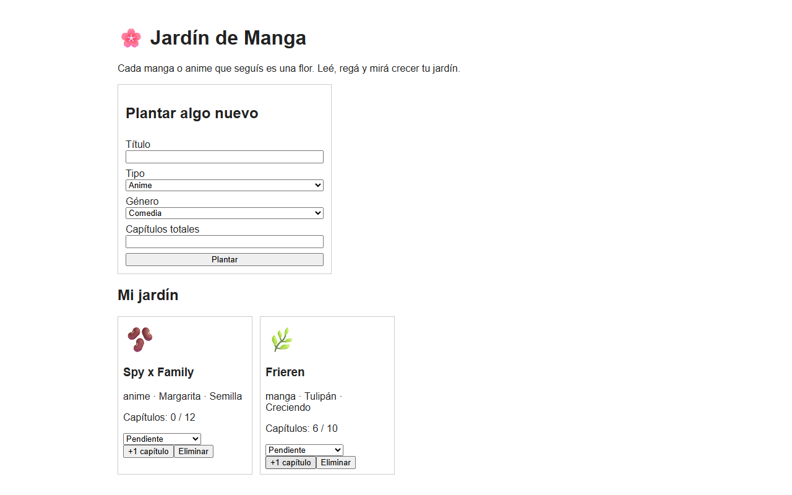
*v0.1 — MVP: el CRUD funciona con Firestore, pero el diseño es básico.*

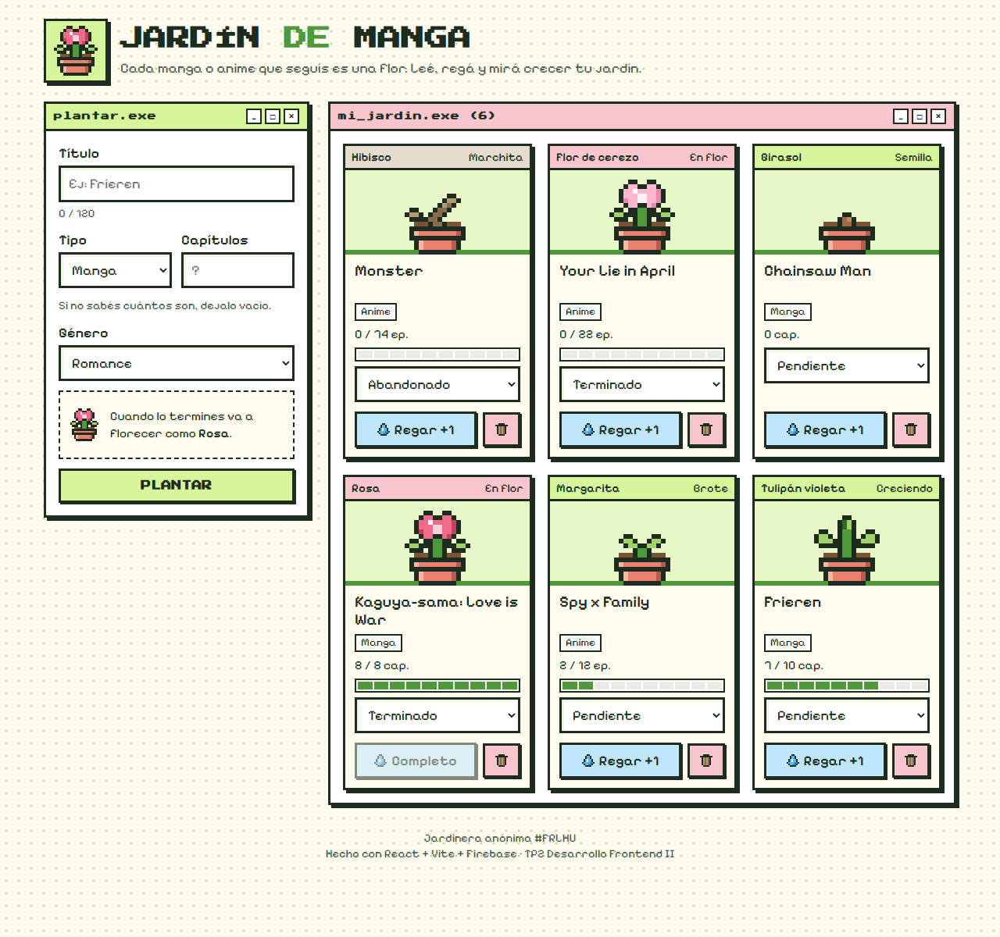
*v0.2 — Identidad pixel art: ventanas tipo "programa", flores dibujadas con código, validaciones y avisos.*

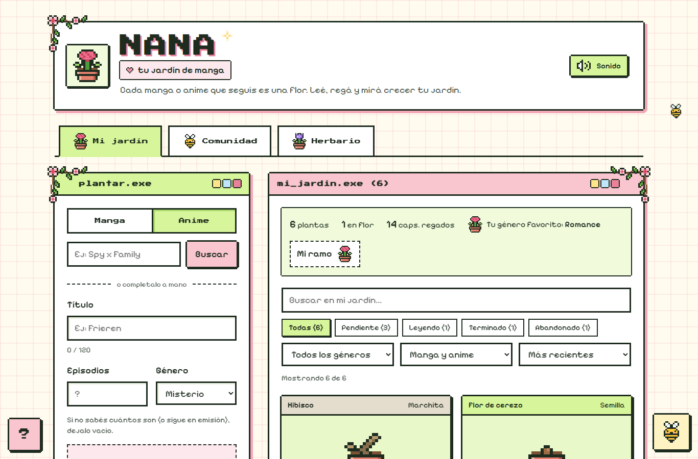
*v1.1 — Pulido kawaii: más espacio, esquinas pixeladas, enredaderas de cerezo y pasto con margaritas.*

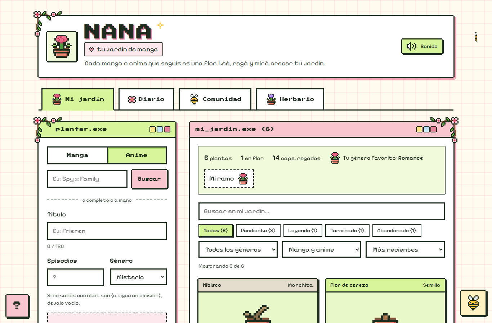
*v1.2 (final) — Cuatro pestañas (Mi jardín, Diario, Comunidad, Herbario), "Mi ramo" con estadísticas y filtros del jardín.*

### La versión final
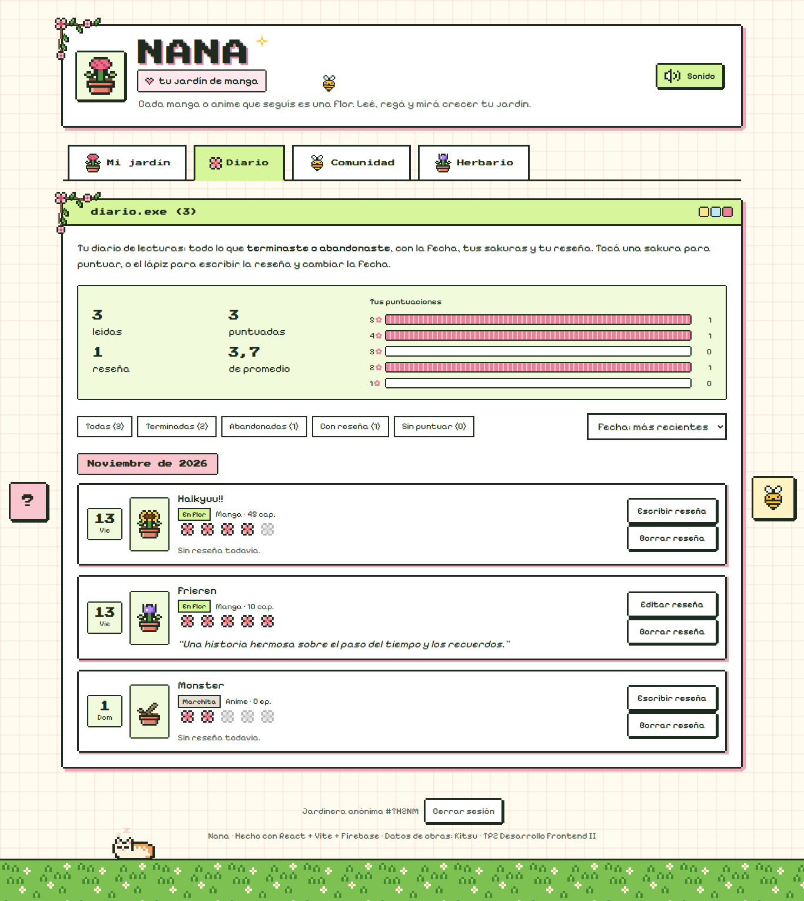
*Diario de lecturas (v1.2): lo terminado o abandonado, por mes, con resumen, gráfico de puntuaciones, sakuras y reseñas.*

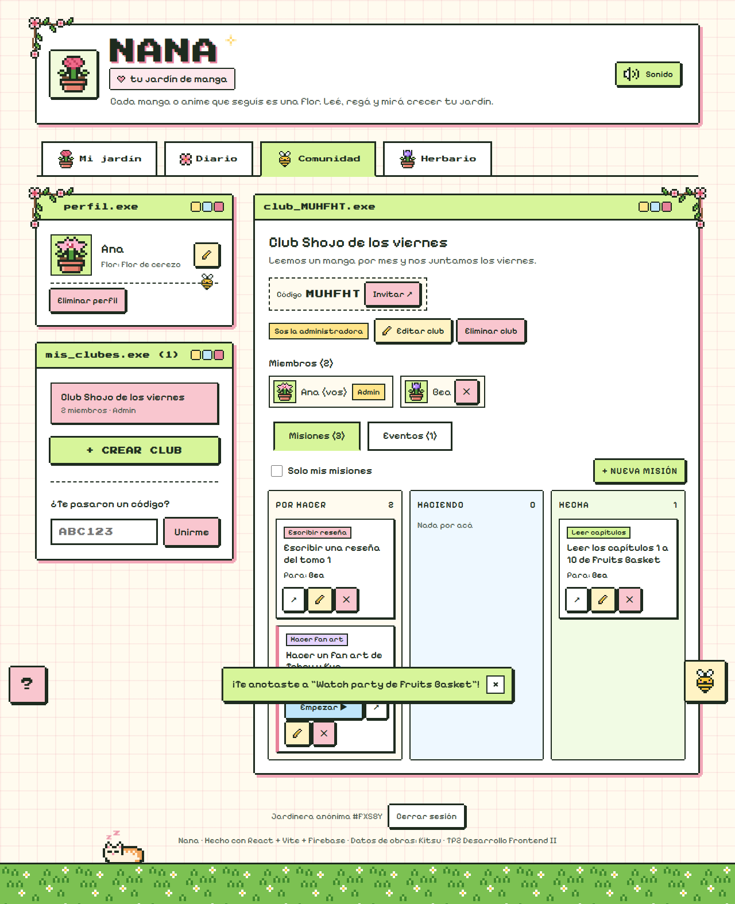
*Comunidad, vista de la administradora: código para invitar, miembros, misiones en un tablero Kanban y el botón "+ Nueva misión" (solo ella puede asignarlas). Abajo se ve un aviso de éxito y el gatito sobre el pasto.*

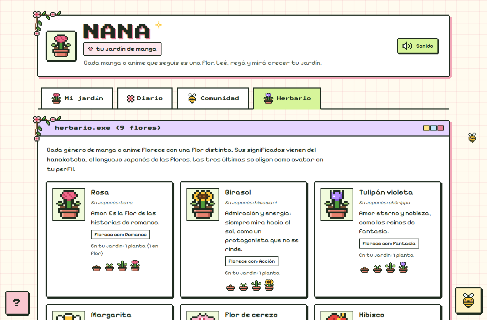
*Herbario: las 9 flores con su significado en japonés (hanakotoba).*

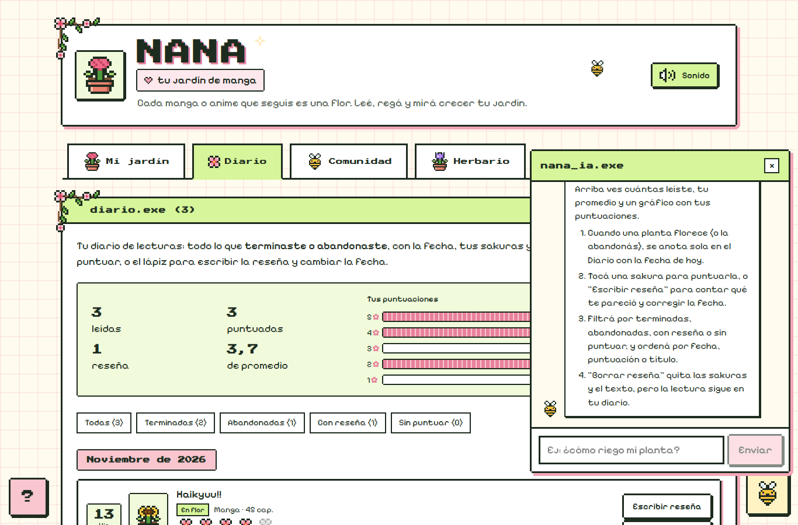
*Nana IA responde paso a paso, solo sobre la app y sin claves externas.*

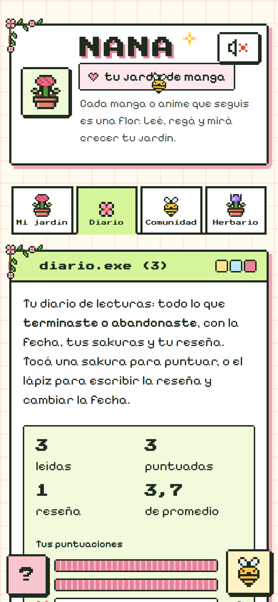
*La misma app en un celular (390 px): una columna y las 4 pestañas completas.*

### Firebase
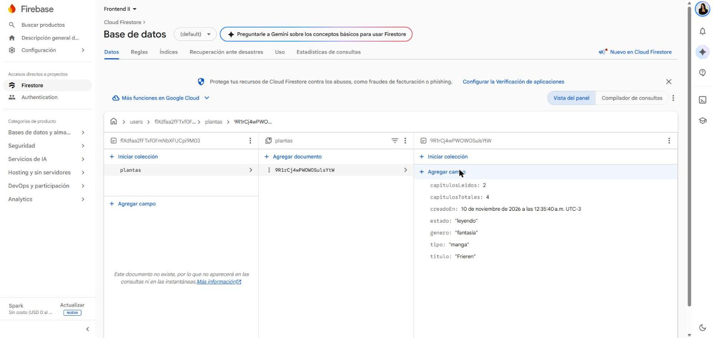
*Un registro creado desde la app, visto en Firestore → Datos.*

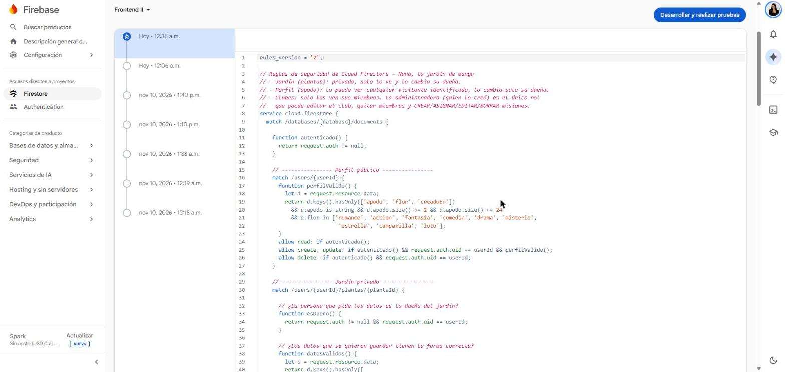
*Las reglas publicadas en Firebase: solo aceptan campos conocidos y con la forma correcta.*
